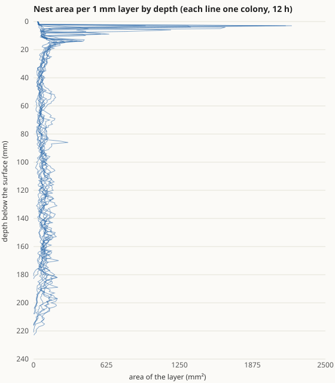

# 土の湿り気の報告

- 日付: 2026-10-19
- 計測環境: Node 24.19 / Intel Core Ultra 7 265K（20 論理コア）
- 設計: [ARCHITECTURE.md](../ARCHITECTURE.md)、根拠: [BIOLOGY.md](../BIOLOGY.md)（PHY-ENV-005、ASM-ENV-007、BIO-NST-003、BIO-COL-007、ASM-COL-015）、[ENGINEERING.md](../ENGINEERING.md)（ENG-ENV-003、ENG-EXP-007）
- 前提: 巣の形の報告の判断事項 3（次は土の湿り気。部屋の間隔の手がかりも兼ねる）を「進めて」で採用

**結論: 土の湿り気を入れ、湿り気で掘る速さが変わるようにしました。開発に使っていないシードで、乾いた土の基準（10/10）と雨のあとの基準（9/10）に合格しました。巣の形の基準も 8/10 で満たしたままです。Phase 7 の測り直しもすべて合格です（育房の温度は 10/10 から 8/10 に下がりました）。ただし、縦坑に沿って部屋が並ぶ手がかりにはなりませんでした。育房が湿り気を避ける規則は、ふつうの天気では効く場面がありませんでした。**

## 1. 実装内容の要約

| 領域 | 実装 |
|---|---|
| 湿り気の計算 | 深さ 1 mm ごとの体積含水率 θ。雨は地表の層に入り、入りきらない分は流れ去る。地表の層からは温度と空気の乾き具合に応じて蒸発する（夏の晴れた日に 1 日約 6 mm）。水は深さ方向に拡散し、乾いた土ほど動きにくい（拡散係数は風乾の 0.01 mm²/s から飽和の 10 mm²/s まで指数的。層の間は調和平均なので、乾いた層が水を止める）。深い所は θ = 0.2 に保つ |
| 計算のしかた | 環境の更新（60 s）ごとに陰解法で 1 歩。どのスレッドも時刻 0 から同じ順に進めるので、途中から加わった補助スレッドも同じ値になる |
| 掘る速さ | θ が 0.05 以下では掘らない。0.25 で最大、飽和（0.4）でゼロ（BIO-NST-003） |
| 育房 | 世話係は、温度のずれに「θ が 0.15 より乾いている分 × 50 °C」を足した値で、育房を置く場所の良し悪しを判断する（BIO-COL-007、ASM-COL-015） |
| 表示 | HUD に深さ 2・20・100 mm の θ |
| テスト | 新しい再現テスト: 湿り気 5 件（水の収支、雨が染み込む、晴れると上から乾く、飽和の上限、同じ手順なら同じ値）、乾いた土では掘らない・最適で最も掘る・湿りすぎで減る、同じ温度なら育房は乾いた所から湿った所へ運ばれる |

晴れた日と雨の日の湿り気の動き（開発用の確認）:

| 時刻 | 地表 | 10 mm | 50 mm | 100 mm |
|---|---|---|---|---|
| 開始（06:00） | 0.20 | 0.20 | 0.20 | 0.20 |
| 12 時間後（18:00） | 0.12 | 0.13 | 0.17 | 0.19 |
| 雨 10 mm/h × 1 時間の直後 | 0.34 | 0.33 | 0.26 | 0.17 |
| 雨の 3 時間後 | 0.23 | 0.23 | 0.23 | 0.22 |
| 雨の 2 日後 | 0.11 | 0.12 | 0.15 | 0.17 |

## 2. 合格基準の達成状況

基準は、開発用シード（11〜13）で効果の大きさを見てから、本番の実行の前に決めました（ENG-EXP-007）。開発では、乾いた土で 38〜40% 少なく、雨のあとは 1.21〜1.25 倍でした。

### 2.1 湿り気と掘削（シード 10001〜10010、`field`、最初の穴 半径 3 × 深さ 15 mm）

| 基準 | 結果 | 判定 |
|---|---|---|
| 乾いた土（深い所の θ = 0.08）では、ふつうの土（0.2）より 12 時間の掘削量が 30% 以上少ない（80% 以上） | **10/10**（36〜52% 少ない、中央値 47%） | **合格** |
| 開始 8 時間後に 10 mm/h × 1 時間の雨。雨のあと 6 時間の掘削量が雨なしより多い（80% 以上） | **9/10**（雨なしの 0.97〜1.58 倍、中央値 1.16 倍） | **合格** |
| 水の収支が合う | 再現テストで、1 日分の雨と蒸発のあとの差が 10⁻⁷ mm 未満 | **合格** |

CSV: [掘削量](moisture/moisture-dig.csv)（時間ごとの掘削量を含む）

### 2.2 巣の形（シード 9001〜9010、湿り気あり）

| 項目 | 湿り気なし（巣の形の報告） | 湿り気あり |
|---|---|---|
| 基準（平たい部屋が 1 つ以上、上半分の体積が半分超） | 10/10 | **8/10（合格）** |
| 深さ | 140〜209 mm | 182〜224 mm |
| 上半分の体積 | 56〜69% | 48〜64% |
| 縦坑の太さ | 10.0〜11.5 mm | 9.2〜10.9 mm |
| 深さ 20 mm より下の平たい部屋 | 1 つの巣 | 2 つの巣（86 mm、131 mm） |

上の層が昼に乾いて掘りにくくなるので、巣が深く、上部の割合が下がりました。不合格の 2 つの巣は、上半分の体積が 48% と 50% で、基準をわずかに下回りました。

CSV: [巣ごと](nest-shape/nest-moist.csv)、[層ごとの面積](nest-shape/nest-moist-areas.csv)

### 2.3 Phase 7 の測り直し

| 基準 | 前回（巣の形の報告） | 今回 | 判定 |
|---|---|---|---|
| 昼夜 | 10/10 | 10/10（昼 0.72〜0.84 匹、夜 0） | 合格 |
| 育房の温度（運ばない対照より 30% 以上 28 °C に近い） | 10/10 | **8/10**（1.89〜3.11 °C 対 3.78〜3.83 °C） | 合格 |
| 涼しい日・暑い日 | 10/10・10/10 | 10/10・10/10（始まり 6:27 対 5:14、暑い日の昼 0 匹） | 合格 |
| 雨（対照と比べる） | 10/10 | 10/10（参考：雨の前と比べると 9/10） | 合格 |
| 水滴に踏み込まない | 0 回 | 0 回 | 合格 |
| 動員（新しい餌場） | × 1.68 | × 1.71（178.5 回 対 104.4 回） | 合格 |

育房の温度が 8/10 に下がったのは、世話係が乾いた上の層を避けるようになったためです。朝に暖まる浅い層は昼に乾くので、温度だけを見れば最適な場所でも、乾いていれば育房を置かなくなりました。温度と湿り気を両立させた結果で、基準は満たしています。

CSV: [昼夜と育房](phase-7/environment-recheck3-day.csv)、[温度](phase-7/environment-recheck3-temp.csv)、[雨](phase-7/environment-recheck3-rain.csv)、[新しい餌場](phase-7/environment-recheck3-food.csv)

Phase 5・6 のシナリオは環境がないので、湿り気は働きません。状態ハッシュの基準値も変わっていないので、測り直していません。

## 3. 分かったこと・できなかったこと

- **部屋の間隔の手がかりにはならなかった。** 湿り気は深さとともになめらかに変わるだけで、特定の深さに印をつけません。縦坑に沿った部屋は 1 つから 2 つの巣に増えただけです。
- **育房の規則は、ふつうの天気では効く場面がない。** 開発用シードで 48 時間比べても、育房のいる深さ（30〜40 mm）はいつも θ = 0.17〜0.19 で十分に湿っていて、規則のあり・なしで差がありませんでした。規則が働くこと自体は再現テストで確かめています。乾いた日が続く設定なら効くはずですが、今回は測っていません。
- **雨のあとの掘削の増え方は小さく、ばらつく**（0.97〜1.58 倍）。雨の直後は地表がほぼ飽和していて、かえって掘りにくくなります。乾き始めてから掘削が増えます。

## 4. 仮定の一覧（今回加えたもの）

| ID | 内容 | 確度 |
|---|---|---|
| PHY-ENV-005 | θ の範囲 0.03〜0.4、拡散係数 0.01〜10 mm²/s、裸地の蒸発 毎時 0.25 mm | 二次資料（土壌物理の一般値） |
| ASM-ENV-007 | 深い所の θ = 0.2。水は深さ方向にだけ動き、重力による排水は表さない | 仮定 |
| BIO-NST-003 | 湿るほど速く掘り、極端に湿ると遅い。乾いた端 0.05、最適 0.25 は仮定 | 同属・別亜科・要旨のみ |
| BIO-COL-007 | 育房を世話する個体は湿った所を好む | 別亜科（ヒアリ）・要旨のみ（書誌は要確認） |
| ASM-COL-015 | 乾きの重み（0.15 より乾いた分 × 50 °C） | 仮定 |
| ENG-ENV-003 | 陰解法で 60 s ごと、全スレッドが時刻 0 から同じ順に進める | 計算の方法 |

## 5. 判断していただきたいこと

1. **部屋が縦坑に沿って並ばないこと。**
   - 推奨: いったん打ち切り、未解決として残す。巣の形の作り直しと湿り気のどちらでも並びませんでした。
   - 次に試すなら、地温の日変化に合わせて育房が上下に移ることを手がかりにする案があります。ただし、Phase 7 で育房は 2 日目に深い所に落ち着くと分かっているので、見込みは高くありません。
2. **巣の上部の割合が下がったこと**（基準ぎりぎりの巣が 2 つ）。
   - 推奨: このままにする。乾いた上の層を掘りにくいのは、湿り気を入れた当然の結果です。
3. **次に何をするか。**
   - 推奨: 地表の景色の記憶（スカイライン、Phase 4 から先送り）。帰巣の精度に効く、目に見える改善です。
4. **前から未回答のもの:**
   - git 履歴の 28 MB の削除（force push が必要）
   - 地形の端の扱い
   - 文献の原典の確認（今回の BIO-NST-003 と BIO-COL-007 の書誌を含む）
