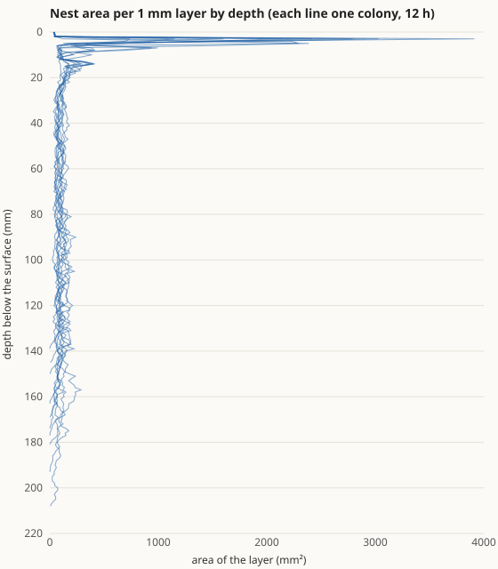
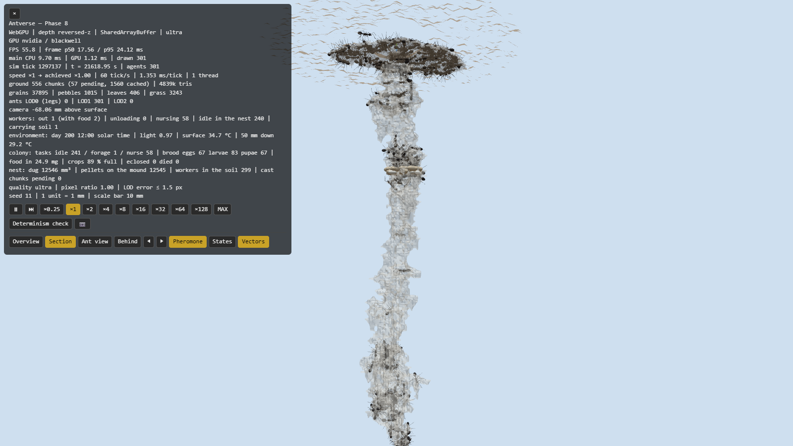

# 巣の形の報告 — 縦坑と部屋（掘削ルールの作り直し）

- 日付: 2026-10-18
- 計測環境: NVIDIA GeForce RTX 5070 Ti / Chrome（WebGPU、ultra 画質）/ Node 24.19 / Intel Core Ultra 7 265K（20 論理コア）
- 設計: [ARCHITECTURE.md §4.3](../ARCHITECTURE.md)、根拠: [BIOLOGY.md](../BIOLOGY.md)（BIO-NST-001、ASM-NST-003/006/008/009/010）、[ENGINEERING.md](../ENGINEERING.md)（ENG-EXP-006）
- 前提: Phase 8 の判断事項 4（次は巣の形）、その後の判断「A：掘削ルールを作り直す」（2026-10-16）と「1：この水準で確定して検証する」（2026-10-18）

**結論: 作り直した掘削ルールで、巣は「太い柱」から「地表直下の平たい大部屋 ＋ 縦坑 ＋ 縦坑の途中の育房の部屋」になりました。開発に使っていないシードで、巣の形の基準（10/10）と Phase 5 の基準（すべて）に合格し、Phase 6・7 も測り直してすべて合格です。ただし *Formica* に典型的な「縦坑に沿って部屋が並ぶ形」はまだできていません。**

## 1. 何を変えたか

元のルール（Phase 5）は「仲間が多く空間が狭い所では、誰でも掘る」でした。これだと群れのいる所がそのまま広がり、巣は 1 本の太い柱（幅 20〜25 mm）になりました（[試行の記録](nest-shape/)）。

掘る仕事を 2 つに分けました。

| 仕事 | 誰が・どこで | 根拠 |
|---|---|---|
| トンネル | 働きアリの 30% の「掘削係」が、通路の先端（体より狭い所）で掘る。速さは「掘る衝動」（出会った混み具合の 10 分の記憶）。先端が空いていれば下へ、混んでいれば横へ（部屋の芽）。衝動があると下へ歩いて先端を探す | 狭いトンネルでは一部の個体が掘削の大半を担う（ヒアリ、Aguilar et al. 2018 *Science*）。混み合った空洞から芽が出てトンネルが伸びる（Toffin et al. 2009 *PNAS*） |
| 部屋 | 誰でも、混み具合に応じて、床に立って横に掘る（床は掘らない、天井は床から 5 mm まで）。高さ 5 mm を超える空間（縦坑）では、育房のある所でしか広げない | 部屋は床が水平で高さが一定、縦坑の外側のくぼみとして始まる（*P. badius*、Tschinkel 2004）。育房の山が部屋の大きさの型になる（*Leptothorax*、Franks & Deneubourg 1997） |
| 歩き方・休み方 | 通路では休まない。若い個体は育房の方へ、年長の個体は上へ（荷物のない個体の一律の下向きはやめた） | 若い働きアリは育房とともに深く、年長の個体は上に住む（*P. badius*、Tschinkel 2004） |

開発中に試したもの（約 20 通り、すべて開発用シード 11〜13・21〜22）は [nest-shape/](nest-shape/) に残しています。うまくいかなかった主なもの:
- 齢で上下に分けるだけ、混み合ったら横に掘るだけ、通路で休まないだけ → どれも太い柱のまま。
- 床に立つ個体だけが部屋を広げる（体の向きで判定） → 部屋がまったくできない。

## 2. 合格基準の達成状況

基準は本番の実行の前に決めました（ENG-EXP-006）。

### 2.1 巣の形（シード 9001〜9010、`field`、最初の穴 半径 3 × 深さ 15 mm、12 時間）

縦坑の太さは「深さ 1 mm ごとの層の面積の中央値」。その 3 倍以上の面積が続く層を部屋とし、幅が高さの 2 倍以上なら平たい部屋とします。

| 基準 | 結果 | 判定 |
|---|---|---|
| 平たい部屋が 1 つ以上あり、体積の半分を超える分が上半分にある（80% 以上のコロニー） | **10/10**。平たい部屋 1〜5 個（すべての巣で地表直下 3〜4 mm に大部屋、面積 996〜3,913 mm²。7 つの巣で 6〜14 mm にもう 1 つ）。上半分の体積 56〜69% | **合格** |

| 記録した値 | 範囲 |
|---|---|
| 掘った体積 | 18,463〜24,567 mm³ |
| 深さ | 140〜209 mm |
| 縦坑の太さ（層の面積の中央値を円にした直径） | 10.0〜11.5 mm |
| 縦坑に沿った部屋（深さ 20 mm より下） | 1 つの巣（9005）で 157・159 mm に小さな平たい部屋。ほかはなし |

CSV: [巣ごと](nest-shape/nest.csv)、[層ごとの面積](nest-shape/nest-areas.csv)

6 時間後の巣（シード 11、開発用）。上の平たい大部屋に大半の個体が休み、縦坑の途中（約 35 mm）に育房の部屋（白い粒）があり、縦坑に沿って小さなふくらみが続きます。

### 2.2 Phase 5 の基準（シード 5001〜、50/100/200/400 匹 × 5、12 時間）

| 基準 | Phase 5 の報告時 | 今回 | 判定 |
|---|---|---|---|
| 頭打ち（最後の 20% が最大の 20% 未満） | 20/20 | **20/20** | 合格 |
| 体積が匹数に比例 | V = 2055 + 51.3·N、R² = 0.982 | **V = 1011 + 63.6·N、R² = 0.997** | 合格 |
| つながり・土の粒数 | すべて | **すべて** | 合格 |

深さは大きく変わりました。

| 匹数 | Phase 5 の報告時 | 今回 |
|---|---|---|
| 50 | 24〜41 mm | 63〜85 mm |
| 100 | 31〜43 mm | 83〜144 mm |
| 200 | 37〜51 mm | 154〜191 mm |
| 400 | 48〜56 mm | 211〜260 mm |

元の巣は浅い漏斗形でした。今回は縦坑が伸びるため深くなります。*F. pallidefulva* の巣は 30〜45 cm（BIO-NST-001）ですが、数か月かけて大きなコロニーが作る深さです。12 時間で 400 匹が 26 cm は速すぎる可能性があります（§4）。

CSV と図: [結果](phase-5/digging-nestshape.csv)、[体積の推移](phase-5/digging-nestshape-volume.svg)、[匹数との関係](phase-5/digging-nestshape-scaling.svg)、[深さごとの体積](phase-5/digging-nestshape-depth.svg)

### 2.3 Phase 6・7 の測り直し（同じシード）

| 基準 | 前回（Phase 8） | 今回 | 判定 |
|---|---|---|---|
| P6 除去からの回復 | 10/10 | **9/10**（対照比 0.72〜1.18） | 合格 |
| P6 齢による分業 | 10/10 | 10/10 | 合格 |
| P6 餌の収支 | 10/10 | 10/10 | 合格 |
| P7 昼夜 | 10/10 | 10/10（昼 0.66〜0.79 匹、夜 0） | 合格 |
| P7 育房の温度 | 10/10 | 10/10（2.05〜2.63 °C 対 3.78〜3.83 °C） | 合格 |
| P7 涼しい日・暑い日 | 10/10・10/10 | 10/10・10/10（始まり 6:27 対 5:14、暑い日の昼 0 匹） | 合格 |
| P7 雨（対照と比べる） | 10/10 | 10/10（参考：雨の前と比べると 8/10） | 合格 |
| P7 水滴に踏み込まない | 0 回 | 0 回 | 合格 |
| P7 動員（新しい餌場、ほかに餌なし） | × 1.64 | **× 1.68**（176.7 回 対 105.4 回） | 合格 |

Phase 6 の CSV にある「動員 × 1.09 → FAIL」は、Phase 7 に移した古い測り方の行で、基準ではありません。

CSV: [Phase 6](phase-6/colony-recheck3-removal.csv)・[収支](phase-6/colony-recheck3-economy.csv)、[昼夜](phase-7/environment-recheck2-day.csv)、[温度](phase-7/environment-recheck2-temp.csv)、[雨](phase-7/environment-recheck2-rain.csv)、[新しい餌場](phase-7/environment-recheck2-food.csv)

## 3. 決定論とテスト

| 項目 | 結果 |
|---|---|
| テスト | 34 ファイル・850 件、すべて合格（新しいルールの再現テスト 4 件を追加: 掘削係の割合、先端では掘削係だけが主に下へ掘る、部屋は床も 5 mm を超える天井も掘らない、育房のない縦坑は広げない） |
| 状態ハッシュの基準値 | すべてのプリセットで更新。新しい個体ごとの値（掘る衝動）がハッシュに入るため。掘削のないシナリオ（既定・二重橋・ホーミング）は、その値が 0 のままで動きは変わらない |
| 並列（補助スレッド） | 掘削ログを再生する等価性テストが合格 |
| 縮小した掘削のテスト | 2 時間 → 3 時間に延長。掘削係だけが掘る最初の数時間が遅くなったため。3 時間で頭打ち（最大の 30% 未満）、40 匹が 20 匹の約 2 倍、上が広い |

## 4. 仮定の一覧（今回加えたもの・変えたもの）

| ID | 内容 | 確度 |
|---|---|---|
| ASM-NST-003（変更） | 荷物のない個体の一律の下向き（0.1）をやめた | 仮定 |
| ASM-NST-006（変更） | 「窮屈」はトンネルの先端の判定にだけ使う（広い所の 0.2 倍の掘削はやめた） | 仮定 |
| ASM-NST-008（新） | 若い個体は育房の方へ、年長の個体は上へ（引き 1） | 近縁属（*P. badius*）・二次資料 |
| ASM-NST-009（新） | 部屋は床から横に、高さ 5 mm まで。縦坑は育房のある所だけ広げる。部屋か通路かは水平 7 × 7 mm のうち空いている所が 25 以上か | 近縁属（*P. badius*、*Leptothorax*）・二次資料、値は仮定 |
| ASM-NST-010（新） | 掘削係 30%、掘る衝動の記憶 600 s、下への引き 0.75 | 別亜科（ヒアリ）・要旨、値は仮定 |
| ENG-EXP-006（新） | 巣の形の測り方と合格基準 | 判定の定義 |

## 5. 判断していただきたいこと

1. **縦坑に沿って部屋が並ぶ形（*Formica* の典型）がまだできていないこと。**
   - 推奨: いったんこの水準で main に取り込み、次の課題として残す。
   - 部屋が一定の間隔で並ぶには、深さごとに変わる手がかり（土の湿り気、地温の日変化に合わせた育房の移動先）が要ると考えています。先送りしている「土の湿り気」を入れるときに、あわせて試すのが効率的です。
2. **巣が深くなったこと**（400 匹・12 時間で 21〜26 cm）。
   - 推奨: このままにする。体積の調節（Phase 5 の基準）は保たれていて、深さに数値の基準はありません。
   - 実際の掘る速さと比べられる資料が見つかれば、掘削係の割合と衝動の記憶の長さを合わせ直します。
3. **次に何をするか。**
   - 推奨の順: スマホ用ページの更新 → 土の湿り気（部屋の間隔の手がかりを兼ねる） → 地表の景色の記憶（スカイライン）。
4. **前から未回答のもの:**
   - git 履歴の 28 MB の削除（force push が必要）
   - 地形の端の扱い
   - 文献の原典の確認
