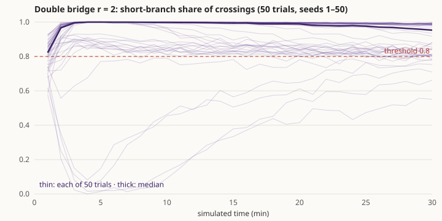
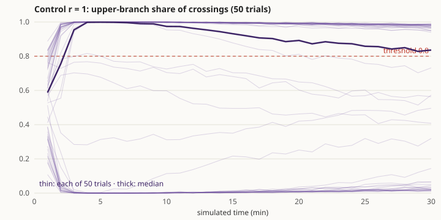
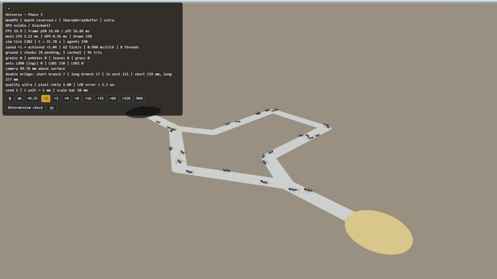
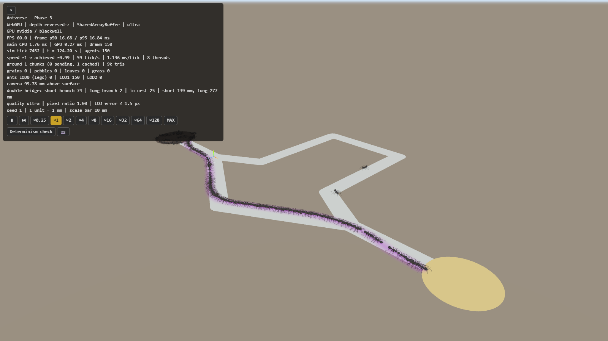
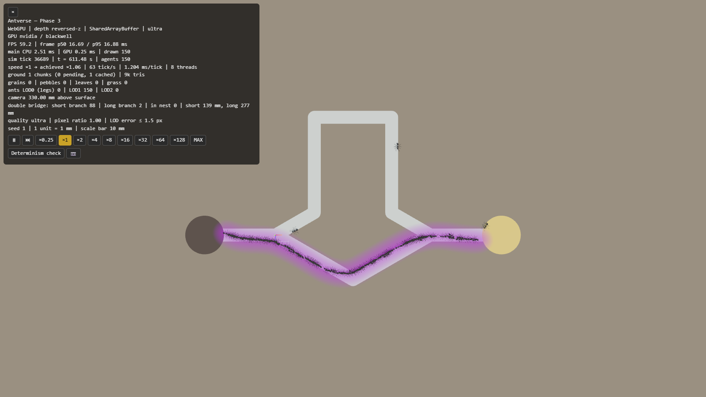
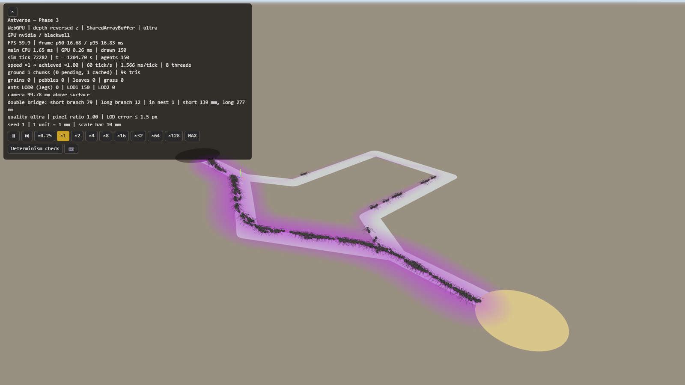
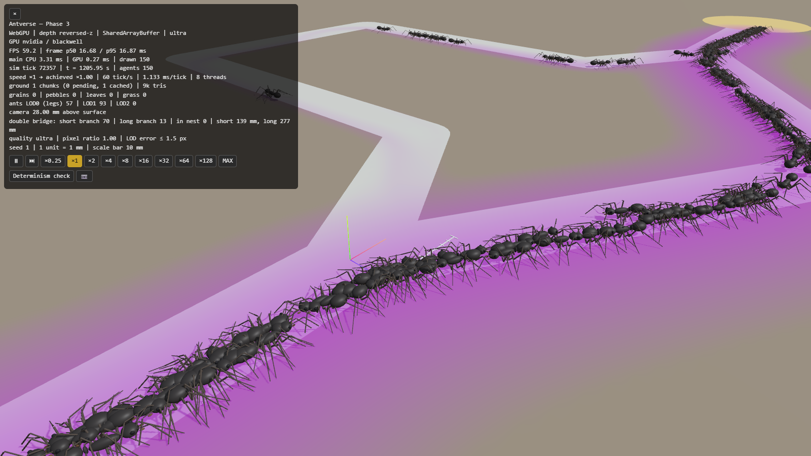
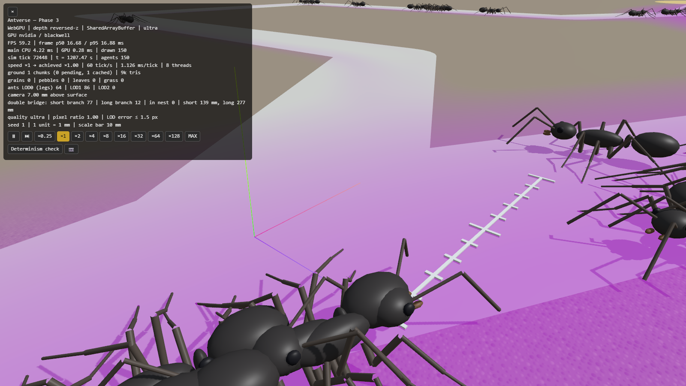
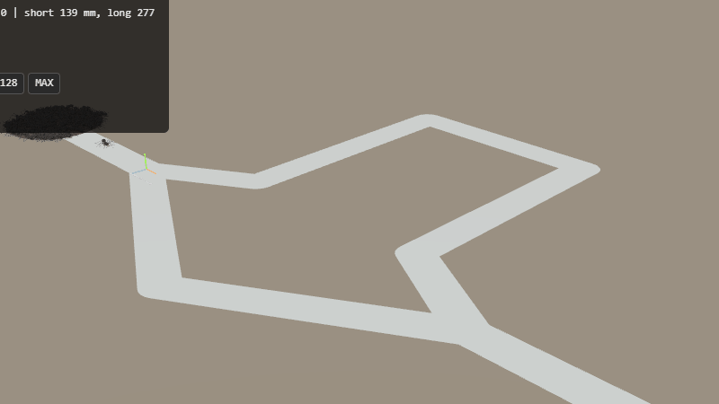

# Phase 3 完了報告 — フェロモンと二重橋

- 日付: 2026-10-11
- 計測環境: NVIDIA GeForce RTX 5070 Ti / Chrome（WebGPU、ultra 画質）/ Node 24.19 / Intel Core Ultra 7 265K（20 論理コア）/ 1600×900
- 設計: [ARCHITECTURE.md §4.2](../ARCHITECTURE.md)、根拠: [BIOLOGY.md](../BIOLOGY.md)（PHE / SEN / NAV / FOR）、[ENGINEERING.md](../ENGINEERING.md)（SCN / PHE / EXP / REN-014・015）
- 前提（承認済みの推奨案）: 二重橋は専用のシナリオ。道しるべは主に帰り道で置き、往路でも少し置く。合格基準は「50 試行のうち、最後の時点で短い枝の交通量の割合が 80% を超えた試行が 80% 以上」。フェロモン場は CPU の格子。

## 1. 実装内容の要約

| 領域 | 実装 |
|---|---|
| 実験装置 | 二重橋（`src/terrain/apparatus.ts`）。巣の円 → 通路 → 分岐 A → 短い枝 138.6 mm / 長い枝 277.1 mm（比 2）→ 分岐 B → 通路 → 餌場の円。両方の分岐点で、2 本の枝は軸の左右に同じ 30° で分かれる。アリは通路の外に出られない。`?preset=double-bridge` で開く |
| フェロモン場 | 1 mm 格子（`src/sim/pheromone/field.ts`）。蒸発は平均寿命 47 分、拡散は陽解法。濃度のある 32×32 タイルとその隣だけを更新する。置く量はスロット順に合流後に加えるので、スレッド数によらずビット単位で同じ |
| 採餌の往復 | 全個体が巣で休んだ状態から始まり、1 匹ずつ出ていく（平均 60 s）。餌場に着くと餌を持って向きを変え、巣に着くと降ろしてまた出る（`forage`） |
| 道しるべを置く | 歩いた距離に比例。帰り道 1 u/mm、往路 0.25 u/mm。巣と餌場の円の中では置かない（`layTrail`） |
| 道しるべを追う | 左右の触角の先で濃度を読み、比 (L − R)/(L + R + 10 u) に比例して旋回する（ウェーバーの法則 + 感覚の下限）（`trail`） |
| 目標への偏りと U ターン | 帰巣中は巣の方向へ、餌場を知っている個体は往路で餌場の方向へ弱く曲がる（Phase 4 の経路積分の代わり）。目標から離れる向きに歩いていると、ときどき U ターンする |
| 行動の優先順位 | 道しるべと目標による旋回は「要求」（`agents.steer`）として出し、探索歩行が、前が通れるときだけ足す。縁や障害物に触れている間は回避だけをする |
| 表示 | 通路・巣・餌場の面と、フェロモンのヒートマップ（対数表示。共有メモリで Worker の格子を直接読む）。HUD に各枝の上の個体数 |
| 実験ツール | `scripts/experiment-double-bridge.ts`（worker_threads で 19 並列、50 試行 × 30 分が 3.5 分）、`scripts/plot-double-bridge.ts`（SVG のグラフ）、`browser-run.ts bridge`（撮影とタイムラプス） |
| テスト | 24 ファイル・478 件、すべて合格。新しい行動ルールごとに再現テストあり（下の表） |

## 2. 合格基準の達成状況

### 本判定: 41 / 50 試行が収束 → **合格**（[double-bridge.csv](phase-3/double-bridge.csv)）

手順（ENG-EXP-001）: 150 匹、シード 1〜50、各 30 分（シミュレーション時間）。交通量は「一方の分岐点から他方の分岐点まで、枝の中央の計数線を通って渡った個体の数」。最後の 5 分間で短い枝の割合が 80% を超えたら収束とする。

| 項目 | 基準 | 結果 |
|---|---|---|
| 収束した試行の割合 | ≥ 80% | **82%**（41/50、95% 信頼区間 69–90%） |
| 短い枝が多数派（> 50%）になった試行 | — | 50/50 |
| 最後の 5 分間の短い枝の割合（50 試行の平均） | — | 0.90 |
| 収束しなかった 9 試行の割合 | — | 0.53, 0.65, 0.71, 0.75, 0.76, 0.79, 0.79, 0.80, 0.80（すべて短い枝が多数派） |

判定に使ったシード 1〜50 は、パラメータを選ぶ間には一度も使っていません（選ぶ間はシード 20261011〜20261048 を使った）。結果が判定用のシードに合わせ込まれていないことを確かめるため、別の 100 シードでも同じ手順を実行しました。

| 実行 | シード | 収束 | 短い枝が多数派 |
|---|---|---|---|
| 本判定 | 1〜50 | 41/50（82%） | 50/50 |
| 確認（[double-bridge-confirm.csv](phase-3/double-bridge-confirm.csv)、[グラフ](phase-3/double-bridge-confirm.svg)） | 1001〜1100 | 88/100（88%） | 100/100 |
| 合計 | 150 試行 | **129/150（86%、95% 信頼区間 79–91%）** | **150/150** |

時間経過（本判定 50 試行の中央値）: 開始 1 分で 0.82、2 分で 0.97、5〜10 分で 1.00、30 分で 0.93。多くの試行は数分で短い枝にほぼ全員が乗りますが、その後ゆっくり長い枝の通行が戻ってきます（グラフの右半分）。最初の 5 分は長い枝が多数派だったのに、最後は短い枝が多数派になった試行も 3 つありました（確認ランでは 5 つ）。これは、*L. niger* で報告されている「後から短い道へ乗り換える」動きに相当します。

### 対照実験: 2 本の枝が同じ長さ（r = 1）（[control-equal-branches.csv](phase-3/control-equal-branches.csv)）

自己組織化なら、同じ長さの枝でも群れはどちらか一方に偏るはずで、どちらを選ぶかは偶然で決まるはずです（Deneubourg et al. 1990）。

| 結果（50 試行） | 数 |
|---|---|
| 上の枝に 80% 超が集中 | 25 |
| 下の枝に 80% 超が集中 | 19 |
| どちらにも偏りきらない | 6 |

44/50 の試行で群れは一方の枝を選び、上下の差（25 対 19）は偶然の範囲です（二項検定 p ≈ 0.45）。r = 2 での短い枝の選択は、枝の長さの差から生まれています。

### 行動ルールの再現テスト

| ルール | テスト | 確かめていること |
|---|---|---|
| フェロモン場 | `src/sim/pheromone/field.test.ts` | 指数減衰が寿命どおり。拡散で総量が保存され、分散が 2Dt に一致。置いた量を同じ点で読める。空のタイルは休む |
| 実験装置 | `src/terrain/apparatus.test.ts` | 長い枝 / 短い枝 = 比。分岐の角度が左右対称。r = 1 で鏡像。点の分類 |
| 巣から出る | `src/sim/rules/trail.test.ts` | 全員が巣で休んで始まり、休んでいる個体は動かず、出ていく数が exitRate の指数分布どおり |
| 往復 | 同上 | 餌場で餌を持って向きを変え、巣で降ろす |
| 道しるべを追う | 同上 | 濃い側へ曲がる。左右が同じなら曲がらない。薄い道しるべへの反応は弱く、濃いと比だけで決まる |
| 目標への偏り・U ターン | 同上 | 帰巣中は巣の方へ、餌場を知っている個体は餌場の方へ曲がる。U ターンの頻度が誤差の大きさどおり（目標を向いていれば 0） |
| 置く | 同上 | 帰り道は往路の 4 倍。巣と餌場の中では置かない。tick の終わりに場へ反映される |
| 通路 | 同上 | 60 匹 × 1 分、通路の外に出た個体は 0 |
| 並列化 | `src/sim/parallel-equivalence.test.ts` | 共有のフェロモン場を補助スレッドと読んでも、1 スレッドとハッシュが一致 |
| 二重橋（縮小版） | `tests/experiments/double-bridge.test.ts` | 2 シード × 10 分で、短い枝の割合 > 0.7、餌の運搬 > 500 回 |
| 決定論 | `tests/determinism/seed.test.ts` | フェロモン場を含めて同じシードで同じハッシュ。二重橋のゴールデンハッシュ `3197a2e9` |

既定設定のゴールデンハッシュは `8e83cdfd` → `46d4cab5` に変わりました。エージェントに状態・歩いた距離・置く量・旋回の要求の 4 つの欄が増え、ハッシュがそれらも含むようになったためです。野外の地面での動き自体は Phase 2 と同じです（二重橋がないと新しいルールは何もしない）。

### 性能（[phase-3-webgpu.csv](bench/phase-3-webgpu.csv)、[phase-3-sim-node.csv](bench/phase-3-sim-node.csv)）

| 個体数 | FPS | GPU | シミュレーション（8 スレッド） | 実時間に対する速さ |
|---|---|---|---|---|
| 10,000 | 59.95 | 4.3 ms | 10.8 ms/tick | ×1.00 |
| 20,000 | 59.95 | 6.4 ms | 16.4 ms/tick | ×0.99 |
| 二重橋 150 匹 | 59.9 | 0.27 ms | 1.0–1.6 ms/tick | ×1.00 |

10k 体・60 fps の目標は保っています。ただし、Node での 1 スレッドの値は Phase 2 の報告より約 40% 遅くなっています（10k 体で 31.8 → 44.6 ms/tick）。原因を確認したところ、Phase 3 の変更ではなく、Phase 2 完了後の監査で入れた「胴体下面の床を、ピッチとロールを含めた正しい位置で測る」修正（コミット cf97bcc）でした。この修正の直後のコミットでも 45.9 ms/tick で、Phase 3 の新しいルールは 10k 体で合計 0.05 ms/tick です。Phase 2 の報告にあるベンチ値は、この修正より前に測ったものです。

## 3. スクリーンショットと動き（[phase-3/](phase-3/)）

シード 1、150 匹。紫がフェロモン（対数表示）。左上の暗い円が巣、右下の黄色い円が餌場です。

| | |
|---|---|
|  22 秒: 巣から出始めた個体が両方の枝に散る（短 7、長 17） |  2 分: 短い枝に道しるべができ、短 74、長 2 |
|  10 分・真上から: 下の V 字が短い枝、上の四角い迂回路が長い枝。曲がり角の内側を通る道ができている |  20 分: 長い枝にも少し通行が戻る（短 79、長 12） |
|  分岐 A の近く |  アリの目の高さ |

タイムラプス（×16、約 16 分）: 

注意: 個体同士は衝突しないので、混んだ通路では重なって見えます（§5 の判断事項 2）。

## 4. 「仮定」として置いたパラメータ

すべて BIOLOGY.md / ENGINEERING.md に登録しました。*F. japonica* の道しるべの定量データは見つからず、*Lasius niger* と *Linepithema humile* の文献で補っています（ASM-SPC-001）。

| ID | 内容 | 値 | 確度 |
|---|---|---|---|
| BIO-PHE-001 | 二重橋の比と分岐の対称性 | 比 2、分岐角 30° | 二次資料（角度は原典で要確認） |
| BIO-PHE-002 | 道しるべの平均寿命 | 2820 s（47 分） | 近縁種から補完（*L. niger*）・二次資料。原典の特定が必要 |
| ASM-PHE-001 | 格子と拡散 | 1 mm、0.02 mm²/s | 仮定 |
| ASM-PHE-002 | 置く量（帰り道 / 往路） | 1 / 0.25 u/mm | 仮定（比は *L. niger* の「主に帰り道」に合わせた） |
| ASM-PHE-003 | 巣と餌場の中では置かない | — | 仮定 |
| ASM-SEN-003 | 触角の位置と左右比較（ウェーバーの法則） | 前方 0.7 L、左右 0.27 L | 仮定（反応の形は Perna et al. 2012） |
| ASM-SEN-004 | 追従の強さと感覚の下限 | 16 rad/s、10 u | 仮定（予備実験で選んだ） |
| ASM-NAV-001 | 目標への偏り（経路積分の代わり） | 2 rad/s per rad | 仮定（Phase 4 で置き換える） |
| ASM-NAV-002 | U ターン | 最大 0.5 /s ×(1 − cos 誤差)/2 | 仮定（現象は Beckers et al. 1992、率は予備実験で選んだ） |
| ASM-FOR-001 | 巣から出ていく割合 | 1/60 /s | 仮定 |
| ENG-SCN-002 | 装置の寸法 | 分岐間 120 mm、幅 10 mm など | 技術的な選択 |

### パラメータを選んだ過程（予備実験、[phase-3/sweeps/](phase-3/sweeps/)）

選ぶ間に使ったシードは 20261011 から。各 38 試行 × 30 分、モデルは途中の版です（右端の列）。

| 条件 | 収束 | モデルの版 |
|---|---|---|
| 下限 5 u、U ターンなし（既定） | 29/38（76%） | U ターン導入前 |
| 往路で置く量 0.5 / 1.0 u/mm | 21/38（55%）/ 19/38（50%）（0.5 の CSV は整理中に誤って削除） | 同上 |
| 巣から出る平均 15 / 30 / 120 s | 53% / 63% / 55% | 同上 |
| 下限 2 / 10 / 20 / 50 u | 50% / 79% / 58% / 68% | 同上 |
| 下限 10 u、U ターン 0 / 0.2 / 0.5 / 1.0 /s | 79% / 82% / **92%** / 95% | U ターン導入後 |
| 下限 20 u、U ターン 0.5 /s | 92% | 同上 |

U ターンの率は、効果が飽和する手前の中間の値（0.5 /s）を選びました。

### 開発中に見つけて直したこと

結果の解釈に関わるので記録します。

- **計数の誤り**: 分岐点の近くでは 2 本の枝の通路が重なるため、最初の計数方法では、長い枝を渡った個体の一部を「短い枝」と数えていました。それまでの収束率はこの誤りで高めに出ていました。枝の中央の計数線で判定する方法に直し、それ以前の予備実験の結果はすべて捨てました。
- **曲がり角での停止**: 道しるべの旋回が縁の回避より強いと、曲がり角の内側に個体が押しつけられて動けなくなっていました。縁に触れている間は回避だけをするように変えました（ルールの優先順位）。
- **巣の中の渦**: 巣の円の中に道しるべが置かれると、円の中を回り続ける個体の群れができていました（ASM-PHE-003）。
- **輪の上の周回**: 2 本の枝は輪になっているので、目標の方向を持たない個体は輪を回り続けました（ASM-NAV-001）。
- **格子の位置**: フェロモン格子の原点が軸に揃っていなかったため、鏡像の装置でも場がわずかに上下非対称でした。格子を 1 mm の整数倍に揃えました（対照実験で確認）。

## 5. Phase 4 に進む前に判断していただきたいこと

1. **合格の余裕が小さいこと。** 本判定は 82% で基準（80%）を満たし、150 試行の合計でも 86% でした。ただし、収束しなかった試行もすべて短い枝が多数派です。基準に届かないのは、数分で短い枝にほぼ全員が乗ったあと、30 分かけて長い枝の通行が少し戻るためです。合格の判断のほかに、次の選択肢があります。
   - **(推奨)** このまま合格とし、Phase 4 で経路積分を入れたあとに二重橋を再実行する。U ターンと目標への偏りは経路積分の代わりなので、そこで結果が変わる可能性が高い。
   - 判定を「最後の 5 分」から「10 分時点」に変える（中央値は 1.00 で、ほぼ全試行が収束する）。
   - 長い枝に通行が戻る仕組みを調べてから進む（道しるべの寿命 47 分が長いこと、ウェーバーの法則では薄い道しるべも比で効くことが候補）。
2. **個体同士の衝突がないこと。** 今は個体同士が重なって通れます。混んだ通路では、混雑そのものが経路の選択を変えることが知られています（*Lasius niger* で混むと長い枝にも分かれる: Dussutour et al. 2004 *Nature*）。推奨: Phase 6（コロニー）で、接触と押し合いを入れる。今すぐ入れると、この Phase の結果が変わります。
3. **文献の確認。** BIO-PHE-001（分岐角）と BIO-PHE-002（寿命 47 分）は二次資料のままです。原典（Beckers et al. 1992 *J. Theor. Biol.* など）を読める環境があれば、値を確かめたいです。*F. japonica* の道しるべ（成分・寿命・置く頻度）の文献をご存じでしたら教えてください。
4. **前のフェーズからの持ち越し**（まだ判断をいただいていないもの）:
   - Git の履歴から 28 MB のフレーム画像を消すかどうか（強制プッシュが必要）
   - Phase 1 の 2 m 四方の端の扱い

## 既知の制約

- 個体同士の衝突がない（判断事項 2）。
- 経路積分はまだない。巣と餌場の方向は誤差なしで分かる前提（ASM-NAV-001）。
- 野外の地面にはフェロモン場を作っていない（Phase 6 で採餌が始まるまで）。
- 道しるべのチャネルは 1 つだけ（警報フェロモンは Phase 7）。
- 動員（帰ってきた個体が巣の仲間を呼び出す）はない。巣から出る割合は一定（ASM-FOR-001）。
- ヒートマップは表示専用で、通路の外へ拡散した分も描く。
- 文献値の確認、ブラウザ間の決定論、実機のスマートフォン、WebGL2 での性能は、Phase 2 から引き続き未確認。
