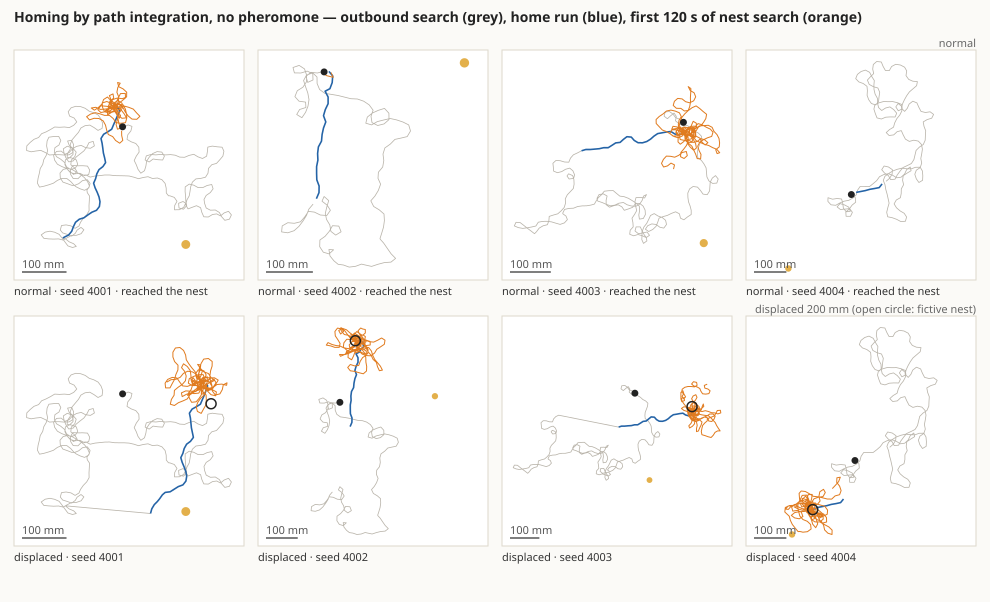
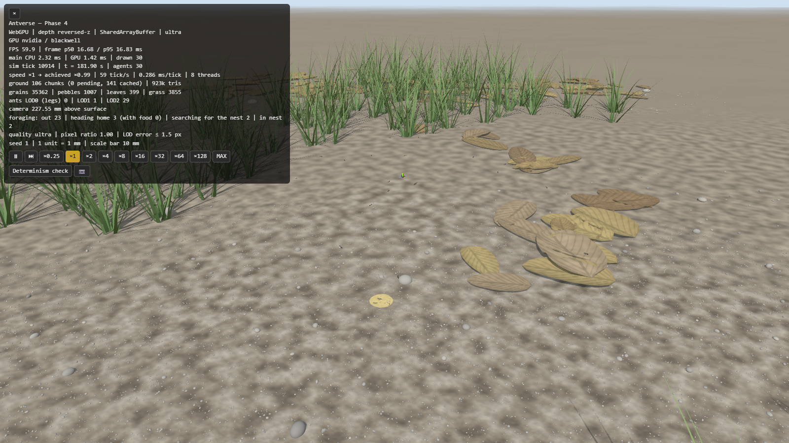
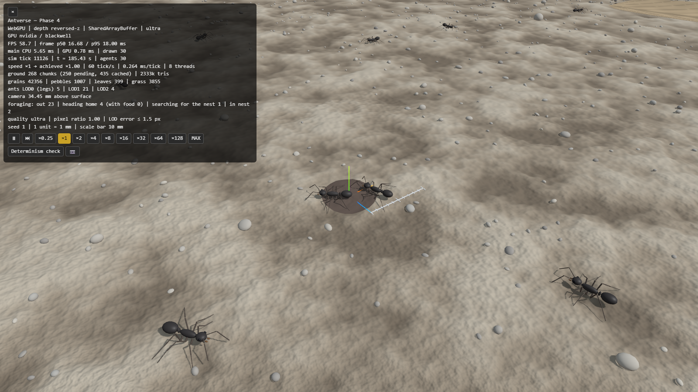

# Phase 4 完了報告 — 経路積分による帰巣

- 日付: 2026-10-11
- 計測環境: NVIDIA GeForce RTX 5070 Ti / Chrome（WebGPU、ultra 画質）/ Node 24.19 / Intel Core Ultra 7 265K（20 論理コア）/ 1600×900
- 設計: [ARCHITECTURE.md §4.7](../ARCHITECTURE.md)、根拠: [BIOLOGY.md](../BIOLOGY.md)（BIO-NAV-001、ASM-NAV-001〜005、ASM-FOR-002、ASM-LOC-008）、[ENGINEERING.md](../ENGINEERING.md)（ENG-SCN-003、ENG-EXP-002）
- 前提（推奨案で進めた）: Phase 3 は合格として扱う。個体同士の衝突は Phase 6 で入れる。合格基準は Phase 4 の計画で示した案（下記）。

## 1. 実装内容の要約

| 領域 | 実装 |
|---|---|
| 経路積分 | 各個体が「巣に対する自分の位置」の推定を持ち、毎ティック実際に動いた一歩を足す。向きはゆっくりさまようコンパスの誤差（標準偏差 0.05 rad、相関時間 20 s）で回り、距離は外出ごとの距離計の倍率（1 ± 0.05）で伸び縮みする。推定を真の位置に合わせ直すのは巣にいるときだけ（`pathIntegrate`） |
| 目標への航法 | 帰巣中は帰巣ベクトル（推定の逆）、往路は記憶した餌場の向きへ曲がる。目標から離れる向きでは U ターンする。Phase 3 の「本当の巣と餌場の位置を知っている」代用品を置き換えた（`navigate`） |
| 巣の探索 | 帰巣ベクトルが尽きても巣がなければ、推定の巣から出て戻るループを、だんだん大きくして探す（Wehner & Srinivasan 1981）。記憶した餌場に餌がないときも同じ探索をする |
| 外出の流れ | 巣で休む → 外出（餌を見つけるか、60〜180 s であきらめる）→ 帰巣 → 巣の探索 → 巣に入って再び外出 |
| 野外のシナリオ | `?preset=homing`（または `#homing`）。巣の入口は原点、餌場は 300 mm 先（向きはシードで決まる）。Phase 1 の地表（小石・落ち葉・草）の上。フェロモン場はない |
| 実験 | `scripts/experiment-homing.ts`（1 匹を放して帰るまで。通常と移動実験、50 試行ずつ並列）、`scripts/plot-homing.ts`（軌跡の図）。二重橋の実験に「途中でフェロモンを消す」を追加（`experiment.wipeAt`） |
| 表示 | 巣の入口と餌場を地表の起伏に沿った円盤で描く。HUD に採餌の状態ごとの個体数 |
| 歩行の修正（Phase 2 の規則） | 段差の下りの限界を登りと分けた（登り 1.4 mm、下り 10 mm）。障害物の前で回る向きを、判断がつかないときは保つ（下の §4） |
| テスト | 26 ファイル・521 件、すべて合格。経路積分・航法・探索・外出の流れ・段差の下りに再現テストを追加 |

## 2. 合格基準の達成状況

### 手順（ENG-EXP-002）

1 試行は 1 匹です。巣から放すと、餌を見つけるか探索をあきらめるまで手がかりなしで歩き回り（往路の中央値 2.7 m）、そこから帰ります。

- **通常:** 帰り始めてから 600 s 以内に巣（入口から 4 mm 以内）に入れば成功。
- **移動実験:** 帰り始めた瞬間に、実験者が個体を 200 mm 動かす（向きはシードで決める）。経路積分で帰っているなら、巣ではなく「動かされなければ巣があったはずの場所（架空の巣）」へ向かい、そこで探すはずです。巣の探索の最初の 60 s の平均位置が、架空の巣から 50 mm 以内で、本当の巣より架空の巣に近ければ成功。
- **合格の条件:** どちらも 80% 以上の試行が成功すること。

### 本判定: **合格**（シード 4001〜4050、[homing.csv](phase-4/homing.csv)）

| 項目 | 基準 | 結果 |
|---|---|---|
| 通常: 巣に帰り着いた試行 | ≥ 80% | **49/50（98%）** |
| 移動: 架空の巣で探索した試行 | ≥ 80% | **48/50（96%）** |

判定に使ったシード 4001〜4050 は、開発中にも、途中の版の判定にも使っていません（§4）。同じ最終版で、ほかの 2 組のシードも実行しました。

| シード | 通常 | 移動 |
|---|---|---|
| 4001〜4050（本判定） | 49/50 | 48/50 |
| 2001〜2050 | 50/50 | 47/50 |
| 3001〜3050 | 50/50 | 47/50 |
| 合計 150 試行 | **149/150（99%）** | **142/150（95%）** |

### 中身の数字（本判定の 50 試行、中央値）

| 項目 | 値 |
|---|---|
| 帰り始めた地点から巣までの距離 | 323 mm（46〜838 mm） |
| 往路の長さ / 帰巣距離 | 7.4 倍（往路は曲がりくねっている） |
| 帰路の直線性（直線距離 / 歩いた距離） | 0.91 |
| 帰巣ベクトルが尽きた点と巣の距離 / 帰巣距離 | 4.9%（上位 10% は 14.5% 以上） |
| 巣に着くまでの時間 | 20 s |
| 移動実験: 探索の中心から架空の巣 / 本当の巣まで | **16 mm / 201 mm** |
| 往路で餌を見つけた試行 | 3/50（ほかは探索をあきらめて帰った） |

上段（通常）: 灰色の曲がりくねった往路のあと、青い帰路は巣へほぼまっすぐ向かいます。帰巣ベクトルの誤差で巣を少し外れた試行は、橙色のループで巣を探して見つけています。
下段（移動実験）: 帰路は巣（黒丸）ではなく架空の巣（白丸）へ向かい、探索もそこを中心にしています。

**失敗した試行:** 通常 1 件、移動 2 件で、いずれも帰巣ベクトルの誤差が 58〜70 mm（帰巣距離の 10〜20%）でした。通常の 1 件は、600 s 以内に、ずれた場所から入口（半径 4 mm）を探し当てられませんでした。移動の 2 件は、探索の中心が架空の巣から 50〜70 mm で、許容の 50 mm をわずかに超えました。

### 仕様の「フェロモンを取り除いても帰れる」について

- **野外:** フェロモン場そのものがありません。上の結果は、道しるべの手がかりなしに経路積分だけで帰れることを示しています（テストでも「場がない」ことを確認）。
- **二重橋（参考の計測）:** 15 分の時点でフェロモンをすべて消しました（[wipe.svg](phase-4/wipe.svg)）。

| 条件（各 50 試行） | 餌の運搬（回/分、中央値）10〜15 分 → 15〜20 分 → 25〜30 分 | 短い枝への収束 |
|---|---|---|
| 経路積分あり | 331 → 346 → 352 | 50/50 |
| 経路積分なし（目標への旋回・U ターンなし） | 422 → 415 → 426 | 31/50 |

どちらの条件でも、消した後に運搬は落ちませんでした。通路の形そのものが道筋を決めているためで、二重橋は「フェロモンなしで帰れるか」を区別できる実験ではありません。一方で、経路積分がないと短い枝への収束が 100% から 62% に下がります（U ターンと目標への旋回が効いている）。

経路積分ありのほうが運搬が少ないのは、目標の向きに曲がる力で通路の壁に押し当てられ、「止まって向きを変える」が増えるためです（§5 の判断事項 2）。

### Phase 3 の二重橋の再計測（経路積分に置き換えた後）

| | Phase 3（代用品） | Phase 4（経路積分） |
|---|---|---|
| シード 1〜50 | 41/50（82%） | **50/50（100%）**、平均割合 0.95 |
| シード 1001〜1100 | 88/100（88%） | **100/100（100%）**、平均割合 0.94 |
| 対照（枝が同じ長さ）: 上 / 下 / 偏りきらない | 25 / 19 / 6 | 22 / 18 / 10 |

対照実験の上下の差は偶然の範囲で、選ばれる枝は今もでたらめです。Phase 3 で「最後の 5 分に長い枝の通行が戻る」と報告した問題は、ほぼなくなりました。

### 行動ルールの再現テスト（追加分）

| ルール | テスト | 確かめていること |
|---|---|---|
| 経路積分 | `src/sim/rules/navigate.test.ts` | 誤差がなければ推定 = 真の位置。距離計の倍率のばらつき、コンパスの誤差の大きさと相関時間が設定どおり。一定のコンパス誤差で推定が回り、距離計で伸びる |
| 推定による航法 | 同上 | 帰巣中は「推定が巣だと言う向き」へ曲がる（本当の巣の向きではない）。往路は記憶した餌場へ。手がかりのない個体は目標なし。U ターンの頻度 |
| 巣の探索 | 同上 | 半径の内側は自由、外に出たら中心を通るまで戻り、次のループへ。半径は時間とともに広がる |
| 外出の流れ | 同上 | 出発時に推定を巣から設定。餌の位置を推定で記憶。あきらめて帰る。ベクトルが尽きたら探索。巣で推定を合わせ直す |
| 段差の下り | `src/sim/rules/explore.test.ts` | 登れない高さの小石の上から降りられる |
| ホーミング（縮小版） | `tests/experiments/homing.test.ts` | 野外にフェロモン場がない。6 試行すべて帰る（往路は帰巣距離の 2 倍以上）。移動した個体は架空の巣で探す。開発中に見つけた 2 件の不具合の再発防止 |
| 並列化・決定論 | `parallel-equivalence.test.ts`、`seed.test.ts` | ホーミングでも 1 スレッドとハッシュが一致。ゴールデンハッシュ: 既定 `7e35a676`、二重橋 `bbd0c0b8`、ホーミング `306d03ba` |

既定設定のゴールデンハッシュが変わった理由は 2 つです。エージェントに経路積分の欄が増えたことと、野外の歩行規則（段差の下り、回る向き）を変えたことです。

### 性能（[phase-4-webgpu.csv](bench/phase-4-webgpu.csv)、[phase-4-sim-node.csv](bench/phase-4-sim-node.csv)）

| 個体数 | FPS | GPU | シミュレーション（8 スレッド） | 実時間に対する速さ |
|---|---|---|---|---|
| 10,000 | 59.95 | 4.6 ms | 10.9 ms/tick | ×1.00 |
| 20,000 | 59.95 | 6.7 ms | 15.2 ms/tick | ×1.00 |
| ホーミング 30 匹 | 59.9 | 1.1 ms | 0.3〜0.6 ms/tick | ×1.00 |

10k 体・60 fps の目標は保っています。Node の 1 スレッドでは 10k 体で 43.4 ms/tick（Phase 3 は 44.6 ms）です。一度 48.8 ms まで遅くなりましたが、障害物を避ける処理で毎ティック・毎個体に関数オブジェクトを作っていたのが原因でした。書き直して元に戻しました（挙動は同じで、ゴールデンハッシュも変わらない）。野外で巣のないシナリオでは、経路積分と航法の規則は何もしません。

## 3. スクリーンショット（[phase-4/](phase-4/)）

シード 1、30 匹、3 分後。

| | |
|---|---|
|  野外の地面。黄色い円盤が餌場（巣から 300 mm）。アリは体長 5 mm なので、この距離では点にしか見えない |  巣の入口（暗い円盤、半径 4 mm）に帰ってきた個体と、出ていく個体 |

ホーミングの様子は、絵より軌跡の図（§2）のほうが分かりやすいです。

## 4. 「仮定」として置いたパラメータと、開発中の変更

### 仮定（BIOLOGY.md / ENGINEERING.md に登録済み）

| ID | 内容 | 値 | 確度 |
|---|---|---|---|
| BIO-NAV-001 | 経路積分と移動実験での振る舞い | — | 二次資料（Müller & Wehner 1988 ほか。*F. japonica* は Fukushi 2001・Fukushi & Wehner 2004） |
| ASM-NAV-001 | 目標へ向かう旋回 | 誤差 1 rad あたり 4 rad/s | 仮定（帰路の直線性 0.9 になるよう選んだ。2 では 0.72） |
| ASM-NAV-002 | U ターン | 最大 0.5 /s | 仮定（Phase 3 から変更なし） |
| ASM-NAV-003 | コンパスと距離計の誤差 | 0.05 rad・20 s、距離 ±5% | 仮定 |
| ASM-NAV-004 | ベクトルの終点と巣の探索 | 3 mm で終点、探索半径 10 mm + 1 mm/s | 仮定（ループの形は Wehner & Srinivasan 1981） |
| ASM-NAV-005 | 巣の入口に気づく距離 | 4 mm | 仮定 |
| ASM-FOR-002 | 探索をあきらめる時間 | 60〜180 s | 仮定 |
| ASM-LOC-008 | 段差（変更） | 登り 1.4 mm、下り 10 mm。判断がつかないときは回る向きを保つ | 仮定 |
| ENG-SCN-003 | 野外のホーミングのシナリオ | 餌場 300 mm、半径 10 mm | 技術的な選択 |

### 開発中に見つけて直したこと

途中の版の判定に使ったシードの失敗を調べて、次の不具合を直しました。どれも特定のシードに合わせた調整ではなく、規則の欠陥です。最終の判定には、どの版でも使っていないシード 4001〜 を使いました。

| 見つけた現象 | 原因 | 修正 |
|---|---|---|
| 小石や落ち葉の上で降りられなくなる（開発用 50 試行中 5 件） | 段差の限界が登りと下りで同じ 1.4 mm だった。ゆるい側から登った物体の上で、周りがすべて「段差」になる | 下りの限界を 10 mm に分けた（Phase 2 の規則の変更） |
| 障害物の前でその場で左右に揺れ続ける（2036） | 回る向きを毎ティック選び直していた。左右の見え方が拮抗すると向きが交互に入れ替わる | 判断がつかないときは回り始めた向きを保つ |
| 上の修正で二重橋の収束率が 66% に低下 | 判断がはっきりしているとき（片側だけ通路）まで向きを保ったため、壁で大回り・U ターンが増えた | はっきりしているときは毎回それに従う。切り分け実験で確認（保持なし 38/38、保持あり 24/38） |
| 記憶した餌場の近くで止まる | 推定の餌場に着いても餌がないと、その点の周りで U ターンを繰り返していた | 巣と同じ探索を餌場の周りでも行う |
| ベクトルの終点が巣から 5 mm なのに、600 s 見つからない（3038） | 探索半径の内側に戻ると自由に歩く規則だったため、半径が広がると円の縁ばかりをなぞった | 中心近く（10 mm 以内）を通るまで戻ってから次のループに出る |

この過程の途中の結果は次のとおりです（通常 / 移動）。

| 版 | シード 2001〜 | シード 3001〜 |
|---|---|---|
| 最初の版 | 46/50 / 46/50 | — |
| 回る向きの保持を追加 | 46/50 / 47/50 | 48/50 / 47/50 |
| 最終版 | 50/50 / 47/50 | 50/50 / 47/50 |

歩行の品質（Phase 2 の基準）は、変更後も満たしています。いずれも 24 匹 × 20 秒の計測です。

| 項目 | Phase 2 の報告 | Phase 4 後 |
|---|---|---|
| 脚の伸びすぎ | 0.65% | 0.45% |
| 膝が固体の中 | 0.042% | 0.019% |
| 胴体の下面が地表より下 | 0.002% | 0.007%（2 フレーム、最大 0.23 mm） |

## 5. Phase 5 に進む前に判断していただきたいこと

1. **景色の記憶（視覚による帰巣）を入れるかどうか。** *F. japonica* は経路積分に加えて、周りの景色（スカイライン）を覚えて帰ることが報告されています（Fukushi 2001）。今回の失敗は、すべて帰巣ベクトルの誤差が大きく、巣の入口を見つけられなかったケースで、景色の記憶があれば救われるものです。推奨: Phase 7（環境）で、空と地平線の描画と合わせて検討する。
2. **通路の壁沿いの歩き方。** 二重橋では、目標へ曲がる力で壁に押し当てられ、「止まって向きを変える」を繰り返すため、運搬量が経路積分なしより約 2 割少なくなります。実際のアリは壁沿いに歩けます。推奨: 地下のトンネルでも同じ問題が出るので、Phase 5（巣の掘削）で壁沿いの歩き方を入れる。
3. **Phase 2 の歩行規則を変えたこと。** 段差の下りの限界と、回る向きの保持です。どちらも、経路積分の実験で初めて見えた不具合への対処です。歩行の品質の基準は満たしていますが、Phase 2 の結果（ゴールデンハッシュ）は変わりました。
4. **持ち越しの判断事項**（まだ返答をいただいていないもの）:
   - Git の履歴から 28 MB を消すか（強制プッシュが必要）
   - Phase 1 の地形の端の扱い
   - Phase 3 の文献（分岐角・道しるべの寿命）の原典の確認

## 既知の制約

- 景色の記憶がない（判断事項 1）。経路積分は水平面だけで、坂道の上り下りは考えていない。
- 餌の発見は偶然だけ: 動員も道しるべもない野外では、50 試行中 3 回しか見つからなかった（Phase 6 で採餌全体を作る）。
- 個体同士の衝突がない（Phase 6）。
- Müller & Wehner (1988) の系統誤差（曲がると一定の向きにずれる）は入れていない。誤差はランダムなものだけ。
- 文献値の確認、ブラウザ間の決定論、実機のスマートフォン、WebGL2 での性能は引き続き未確認。
