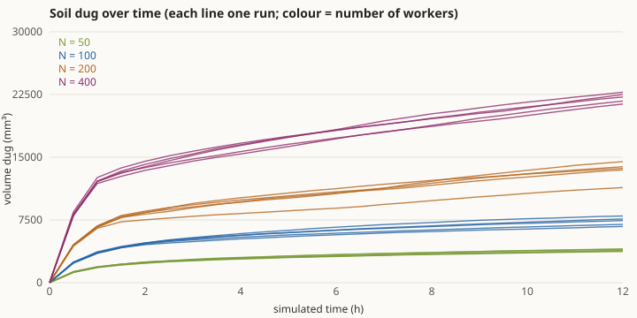
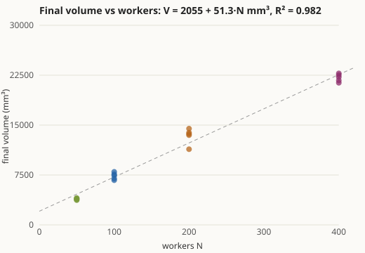
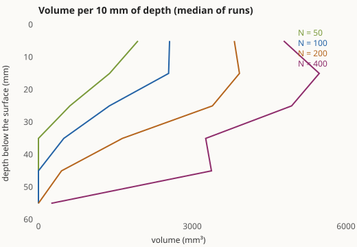
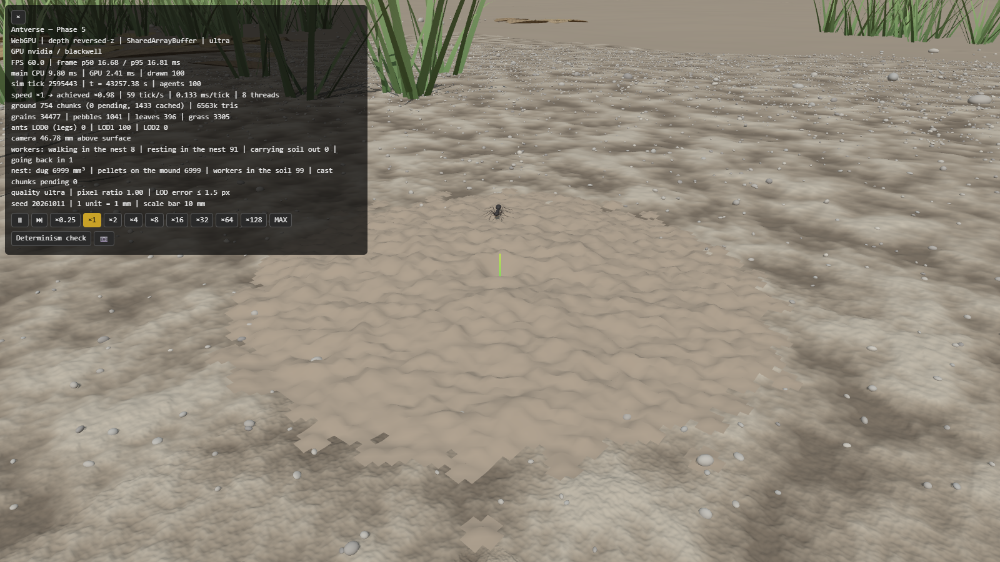
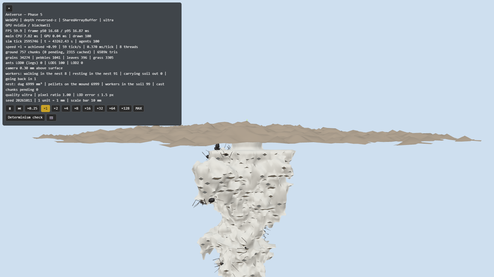
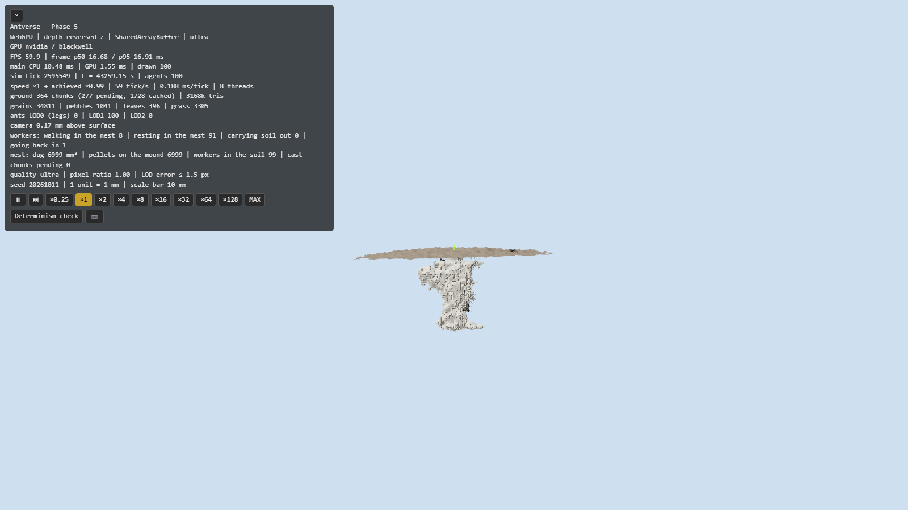
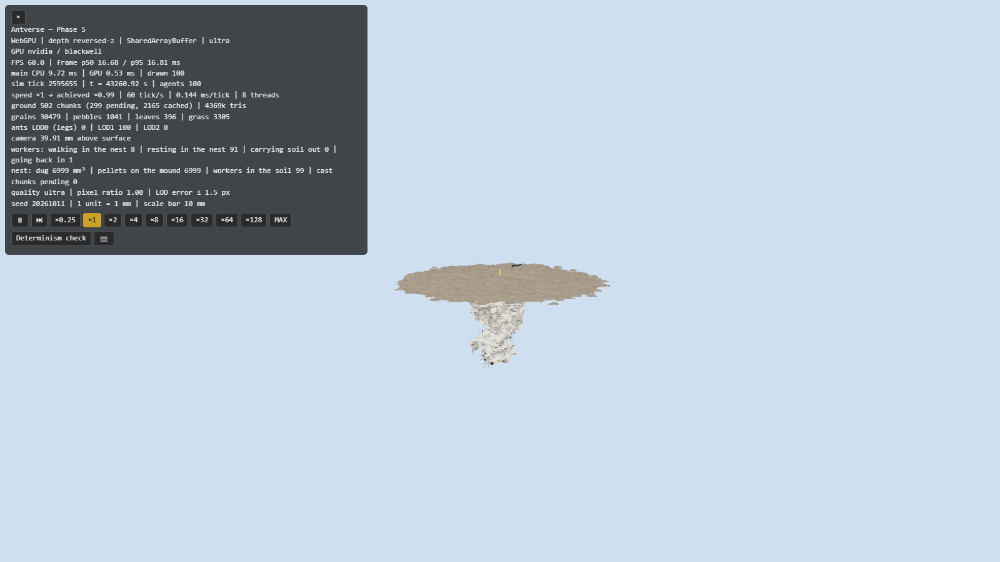

# Phase 5 完了報告 — 巣の掘削

- 日付: 2026-10-12
- 計測環境: NVIDIA GeForce RTX 5070 Ti / Chrome（WebGPU、ultra 画質）/ Node 24.19 / Intel Core Ultra 7 265K（20 論理コア）/ 1600×900
- 設計: [ARCHITECTURE.md §4.3](../ARCHITECTURE.md)、根拠: [BIOLOGY.md](../BIOLOGY.md)（BIO-NST-001/002、ASM-NST-001〜007、PHY-SOIL-002、ASM-LOC-008）、[ENGINEERING.md](../ENGINEERING.md)（ENG-SCN-004、ENG-SOL-001〜003、ENG-REN-016、ENG-EXP-003）
- 前提（推奨案で進めた）:
  - Phase 4 の判断事項: 景色の記憶は Phase 7 で検討、通路の壁沿いの歩き方はこの Phase で入れる
  - 合格基準: 着手時に示した案（下記）
  - Git 履歴の整理は強制プッシュが必要なので、まだ行っていない

## 1. 実装内容の要約

| 領域 | 実装 |
|---|---|
| 土 | 1 mm のボクセル、巣口を中心に 512 × 1024 × 512 mm、32³ のチャンク。掘ったチャンクだけメモリを使う（`src/soil/soil.ts`）。地表から 3 mm は巣口の範囲以外では掘らない（地表の殻） |
| 地下の歩行 | 掘った空間の壁・床・天井を、ボクセルからボクセルへ歩く（26 近傍、角を切らない）。体は壁から離れる向きを上にして、連続的に動く（`burrow`）。土を運ぶ個体は重力に従って上へ向かい、最初に行き当たった地表への出口から出る |
| 掘る規則 | 掘れる面にいて、周り（24 mm 立方）が混み合っている（1 匹あたりの空間が 40 mm³ より狭い）ほど掘る。体より狭い場所では最大の速さで、広い場所では 0.2 倍。どの面を掘るかは、進む向きと下を好む性質で決まる（`excavate`） |
| 休む規則 | 荷物のない個体は、仲間が多い所ほど立ち止まって休み、休んでいると動き出しにくい（群れて休む）。ただし混み合って空間が足りない所では休まず動き、掘る |
| 運搬と土の山 | 掘った 1 粒を地上へ運び、巣口から 10〜40 mm（経路積分の推定で測る）離れた所に落とす。落とした土は、安息角（約 35°）を超えると低い方へ滑り、巣口の周りに山になる（`src/soil/mound.ts`）。山は地形の高さに足され、地上の個体はその上を歩く |
| 共有状態の決定論 | 掘る・落とすは要求として出し、ティックの終わりにスロット順で許可する（同じボクセルを同時に狙ったら若い番号が取る）。混み具合はティックの終わりに数え直す。分割の仕方によらず同じ結果 |
| 表示 | 掘った空間の鋳型（サーフェスネッツ、チャンクごとに作り直す）と土の山。地上を外す表示（`antverse.setCutaway(true)`）で巣の中を見る。地下の個体は脚を固定した姿（LOD1）で描く。`?preset=digging` または `#digging` で開く |
| 実験 | `scripts/experiment-digging.ts`（4 つの人数 × 5 シード × 12 時間を 19 並列で 17 分）、`scripts/plot-digging.ts`、`browser-run.ts nest` |
| Phase 4 からの持ち越し | 二重橋の通路の縁で、片側だけが通路のときは、立ち止まらずに向きを変えながら歩き続ける（壁沿いの歩き方） |
| テスト | 29 ファイル・589 件、すべて合格 |

## 2. 合格基準の達成状況

### 手順（ENG-EXP-003）

働きアリ N = 50・100・200・400 匹 × 5 シード（5001〜5005）。全員が巣口で休んだ状態から始め、手つかずの土を 12 時間（シミュレーション時間）掘らせました。30 分ごとに掘った量を数えます。

### 結果: **3 項目とも合格**（[digging.csv](phase-5/digging.csv)）

| 基準 | 条件 | 結果 |
|---|---|---|
| 1. 掘る量の頭打ち | 最後の 20% の時間の掘る速さが、最も速かった 30 分の 20% 未満になった試行が 80% 以上 | **20/20 試行**（3〜6%） |
| 2. 巣の大きさは人数に比例 | 最終的な体積を人数に対して直線で当てはめ、R² ≥ 0.9 | **R² = 0.982**（V = 2055 + 51.3·N mm³） |
| 3. つながりと土の保存 | 全試行で、掘った空間が巣口とつながり、掘った土 = 運搬中 + 地表の山（ちょうど） | **20/20 試行** |

| 人数 N | 体積（平均 ± 標準偏差） | 1 匹あたり | 深さ | 最後 / 最大の掘る速さ | 上 10 mm の割合 |
|---|---|---|---|---|---|
| 50 | 3,886 ± 133 mm³ | 78 mm³ | 24–41 mm | 0.03–0.04 | 49% |
| 100 | 7,342 ± 503 mm³ | 73 mm³ | 31–43 mm | 0.03–0.04 | 35% |
| 200 | 13,375 ± 1,175 mm³ | 67 mm³ | 37–51 mm | 0.04–0.06 | 29% |
| 400 | 22,112 ± 576 mm³ | 55 mm³ | 48–56 mm | 0.04–0.05 | 22% |

読み取れること:
- **頭打ち:** 最初の 1 時間で一気に掘り、その後は急に遅くなります。ただし完全に止まるわけではなく、最後の数時間も 1 時間に数 % ずつ増えています。
- **人数との関係:** 人数が多いほど巣は大きくなります。ただし 1 匹あたりの体積は N = 50 の 78 mm³ から N = 400 の 55 mm³ へ少しずつ減り、直線は原点を通りません（切片 2,055 mm³）。巣口付近の、どの人数でも掘られる部分が切片に当たると考えられます。
- **形:** 巣は地表の殻の直下が最も広く、深くなるほど細くなります（上が大きい形）。*F. pallidefulva* の「体積が深さとともに減る」と定性的には合っています。一方、*Formica* に典型的な「縦穴に部屋が並ぶ」構造は再現できていません（§5 の判断事項 1）。

### 再現テスト（追加分）

| 規則 | テスト | 確かめていること |
|---|---|---|
| 土 | `src/soil/soil.test.ts` | 地表より上は空気、下は土。掘ると 1 回だけ開く。壁・底・地表の殻は掘れない（巣口を除く）。描画側の写しが一致。状態ハッシュが掘削を反映する |
| 土の山 | 同上 | 体積が保存され、どこも安息角を超えない。巣口には落とさない |
| 地下の歩行 | `src/sim/rules/excavate.test.ts` | 巣口から入る。地下では掘った空間の壁際にしか立たない。荷物なしでは地表に出ない。土を運ぶ個体は 25 mm の縦穴を 5 s 以内に登って出る |
| 掘る | 同上 | 混み具合への反応の式。1 匹だけでは掘らず、混み合うと掘る。同じボクセルを同時に狙ったら若い番号が取る。土の保存（ちょうど）と、掘った空間のつながり |
| 捨てる | 同上 | 決めた距離まで離れてから落とし、戻る |
| 歩行（変更） | `src/sim/rules/explore.test.ts` | 傾き 0.8 以下の土の山の斜面は登る。急な小石の側面は登らずに回り込む |
| 掘削（縮小版） | `tests/experiments/digging.test.ts` | 2 つの人数 × 2 時間: 減速、つながり、保存、人数が多いほど大きい、上が大きい |
| 並列化・決定論 | `parallel-equivalence.test.ts`、`seed.test.ts` | 掘削でもスロットの分け方によらず同じハッシュ。ゴールデンハッシュ: 既定 `a1715efd`、二重橋 `73e15f66`、ホーミング `9498801d`、掘削 `c34758f8` |

既定設定のゴールデンハッシュが変わった理由は 2 つです。エージェントに掘削用の欄が増えたことと、坂の規則（後述）を変えたことです。

### 二重橋とホーミングへの影響（参考の計測）

この Phase では、地表の歩き方も 2 か所変えました（通路の縁で立ち止まらない、土の山のような坂を登れる）。そこで、Phase 3・4 の実験を同じシードで再実行しました。

| 実験 | Phase 4 の報告 | Phase 5 の後 |
|---|---|---|
| 二重橋、シード 1〜50（収束） | 50/50 | 47/50（[CSV](phase-5/double-bridge.csv)） |
| 二重橋、シード 1001〜1100 | 100/100 | 91/100 |
| 二重橋、1 試行あたりの餌の運搬 | 9,397 回 | **11,983 回（+27%）** |
| ホーミング、通常 / 移動（シード 4001〜） | 49/50 / 48/50 | 48/50 / 46/50（[CSV](phase-5/homing-recheck.csv)） |

壁沿いの歩き方で、通路の壁に押し当てられて止まる時間が減り、運搬は Phase 3（10,760 回）も上回りました。短い枝への収束は 100% から 91〜94% に下がりましたが、Phase 3 の基準（80%）は満たしています。ホーミングも Phase 4 の基準を満たしたままです。

### 性能（[phase-5-webgpu.csv](bench/phase-5-webgpu.csv)、[phase-5-sim-node.csv](bench/phase-5-sim-node.csv)）

| 条件 | FPS | GPU | シミュレーション |
|---|---|---|---|
| 地表 10,000 匹 | 59.95 | 4.4 ms | 9.4 ms/tick（8 スレッド）、Node 1 スレッドで 42.9 ms/tick（Phase 4: 43.4） |
| 地表 20,000 匹 | 59.95 | 6.5 ms | 15.2 ms/tick |
| 掘削 100 匹（12 時間後） | 59.9 | 0.04〜2.4 ms | 0.13〜0.37 ms/tick（1 スレッド） |

掘削のシナリオでは、補助スレッドによる並列化を使いません。掘った土のチャンクが調整役のスレッドにしかないためです（§5 の判断事項 3）。

## 3. スクリーンショット（[phase-5/](phase-5/)）

シード 20261011、100 匹、12 時間後（91 匹が巣の中で休み、掘削はほぼ止まっている）。

| | |
|---|---|
|  巣口の周りに広がった土の山（約 7,000 mm³） |  地上を外して見た巣の鋳型（クリーム色）と、その中の働きアリ |
|  鋳型の横から。殻の直下が広く、下へ細くなる |  斜め上から |

## 4. 「仮定」として置いたパラメータと、開発中の変更

### 仮定（BIOLOGY.md / ENGINEERING.md に登録済み）

| ID | 内容 | 値 | 確度 |
|---|---|---|---|
| BIO-NST-001 | *Formica* の巣の形と大きさ | 深さ 30–45 cm、縦穴＋部屋、上が大きい、体積と働きアリ数の相関 R² = 0.87 | 近縁種（*F. pallidefulva*）・二次資料 |
| BIO-NST-002 | 巣の大きさの調節（掘削の頭打ち） | — | 近縁種（*L. niger*）・二次資料 |
| PHY-SOIL-002 | ゆるい土の安息角 | 35°（tan 0.7） | 二次資料（一般値） |
| ASM-NST-001 | 1 粒と掘る速さ | 1 mm³、最大 0.05 粒/s | 仮定 |
| ASM-NST-002 | 混み具合への反応 | 1 匹あたり 40 mm³、ヒル係数 4、24 mm 立方 | 仮定 |
| ASM-NST-003 | 地下の歩き方 | 方向の持続 2、運搬は上へ 2、掘る面は下を好む 2、歩きは下へ 0.1 | 仮定 |
| ASM-NST-004 | 土を捨てる距離 | 10–40 mm | 仮定 |
| ASM-NST-005 | 地表の殻 | 3 mm（巣口の半径 4 mm を除く） | 仮定 |
| ASM-NST-006 | 体に合わせたトンネル | 26 近傍の空きが 17 未満で窮屈、それ以外は 0.2 倍 | 仮定 |
| ASM-NST-007 | 群れて休む | 止まる 0.01 + 0.01 × 仲間 /s、動き出す 0.05 / (1 + 0.5 × 仲間) /s、混雑で休まない | 仮定（群れの現象は Depickère et al. 2004） |
| ASM-LOC-008 | 坂（変更） | 傾き 0.8 以下なら 1.4 mm を超えても登る | 仮定 |

*F. japonica* の巣の構造と掘削の定量データは、日本語・英語とも見つかりませんでした。

### 開発中に見つけて直したこと

掘削の規則は、試しながら次の順に組み立てました。どれも、そのとき見えた現象への対処です。

| 現象 | 原因 | 対処 |
|---|---|---|
| 地表直下が浅いくぼみ状に掘られ、巣口のボクセルの周りに足場がなくなる | 地表の層まで掘っていた | 地表 3 mm の殻を残す（巣口を除く） |
| 1 ボクセル幅の縦穴が 30 分で 60 cm まで伸びる | 体の大きさの制約がなかった | 体より狭い所で掘る規則（トンネルが体の幅以上に広がる） |
| 掘る個体が全員縦穴の底に集まり、掘り続ける | 歩くときの下向きの傾向が強すぎた | 「掘る面の選び方」と「歩き方」の下向きを分け、歩き方は弱く（0.1） |
| 掘る速さが減るだけで止まらない | 土を運ぶ往来が巣口付近の混雑を保ち、それがまた掘削を促した | 群れて休む規則。混雑がない所では休み、休む個体が増えると掘削が止まる |
| 群れて休む規則だけだと、最初の小さな穴で全員が休む | 混み合った所でも休んでいた | 空間が足りない所では休まず動く（混雑は掘る刺激） |
| 土を運ぶ個体が平たい部屋の天井で行き来を続ける | 地下でも経路積分の推定で巣口を目指し、推定の誤差で縦穴を外した | 地下では重力に従って上へ |
| 地上で土を持った個体が巣口から出られない | 土の山が巣口の縁で崖になり（巣口に土が流れないようにしていた）、さらに 35° の斜面を「壁」と判定していた | 巣口にも土が滑り込むようにし、坂の規則を加えた |
| 巣口に戻る個体が地上で迷い続ける | 経路積分の誤差で巣口を外したとき、巣の探索に移っていなかった | Phase 4 の巣の探索をこの状態にも適用 |

開発中の確認には既定のシード（20261011）を使い、判定のシード（5001〜5005）は使っていません。

歩行の品質（Phase 2 の基準）は、坂の規則を入れた後も満たしています（24 匹 × 20 秒）。

| 項目 | Phase 4 | Phase 5 |
|---|---|---|
| 脚の伸びすぎ | 0.45% | 0.66% |
| 膝が固体の中 | 0.019% | 0.021% |
| 胴体の下面が地表より下 | 0.007%（2 フレーム、最大 0.23 mm） | 0.007%（2 フレーム、最大 0.03 mm） |

## 5. Phase 6 に進む前に判断していただきたいこと

1. **巣の形。** 基準は満たしましたが、できる巣は「殻の直下が最も広い漏斗形」で、*Formica* らしい縦穴と部屋の並び（BIO-NST-001）にはなっていません。部屋が深さごとに分かれるには、深さによって変わる手がかり（湿り気・温度・巣の中の物の置き場所）が要ると考えています。
   - **推奨:** Phase 6（コロニー: 卵・幼虫を置く場所、餌の貯蔵）と Phase 7（環境: 土の湿り気・地温）で、部屋が分かれる手がかりを入れてから再評価する。
   - 今すぐ形を詰めることもできますが、手がかりのない今の段階では、パラメータで形を作ることになりやすいです。
2. **頭打ちの度合い。** 掘る速さは最大時の 3〜6% まで落ちますが、ゼロにはなりません（12 時間後も 1 時間に数 % 増える）。実際の巣も、コロニーが育つにつれて大きくなり続けます。コロニーの成長は Phase 6 で入れます。
3. **掘削中の並列化。** 掘削のシナリオは 1 スレッドで動きます（100 匹で実時間の数十倍）。Phase 6 で数千匹のコロニーが巣を掘るには、土のチャンクを共有メモリに置く仕組みが必要です。推奨: Phase 6 の最初に入れる。
4. **歩行規則の変更（Phase 2 の規則）。** 坂の規則と、通路の縁で立ち止まらない歩き方です。歩行の品質の基準は満たしていますが、Phase 3・4 の結果は少し変わりました（上の表）。
5. **持ち越し**（まだ返答をいただいていないもの）:
   - Git 履歴から 28 MB を消すか（強制プッシュが必要）
   - Phase 1 の地形の端の扱い
   - 文献の原典確認（Phase 3 の分岐角・道しるべの寿命、Phase 5 の Mikheyev & Tschinkel 2004 は PDF が画像のため本文の数値を確認できず）

## 既知の制約

- 巣の形が縦穴＋部屋にならない（判断事項 1）。
- 地下の個体は脚を地表で解かないので、壁の上では脚が動かない（LOD1 の固定姿勢）。
- 地下の個体どうしの衝突がない（Phase 6）。体の大きさは「トンネルの太さ」としてだけ効いている。
- 巣口は 1 つだけ。地表の殻を掘らないので、新しい出入り口はできない。
- 土の水分・崩れ（トンネルの崩落）・地温はない（Phase 7）。
- 地下では経路積分を使わず、重力だけで上へ向かう。
- 掘削中は補助スレッドを使わない（判断事項 3）。
- 文献値の確認、ブラウザ間の決定論、実機のスマートフォン、WebGL2 での性能は、引き続き未確認。
