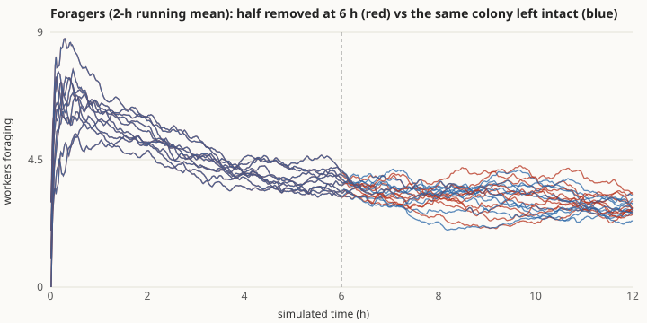
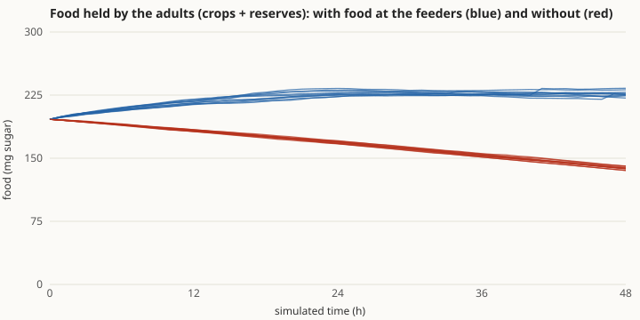
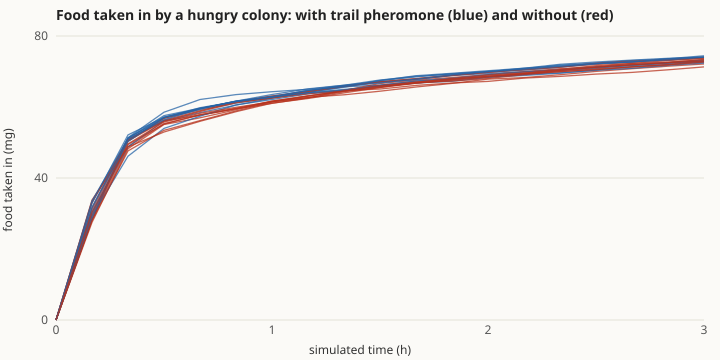
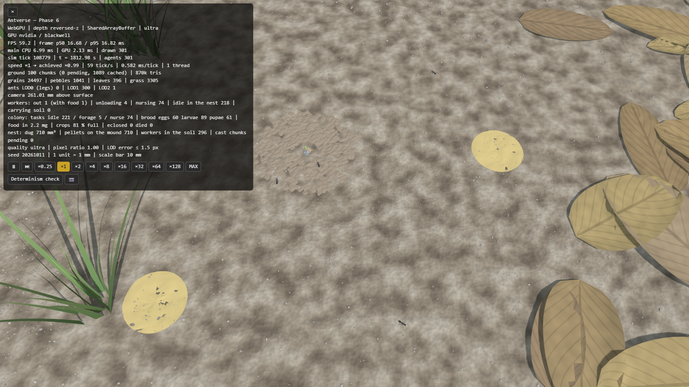
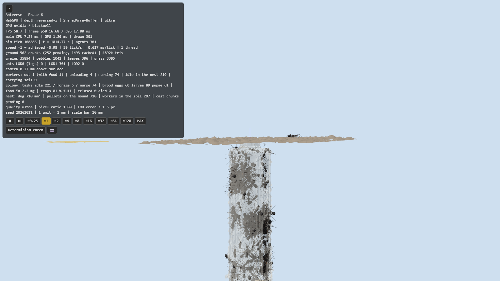
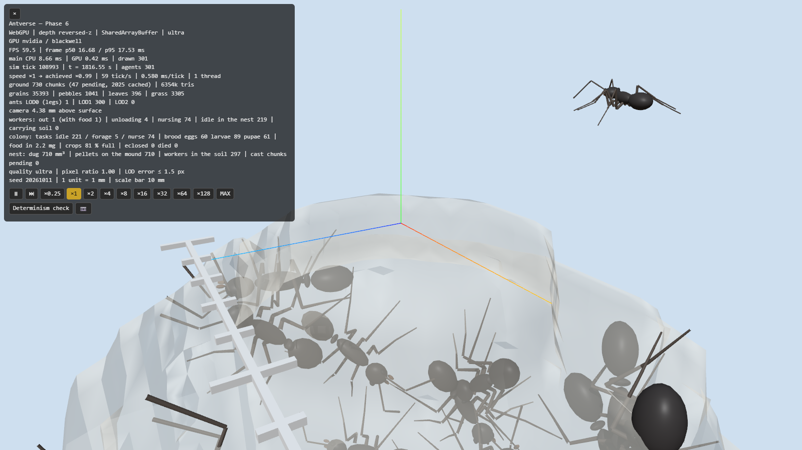

# Phase 6 報告 — コロニー（生活環・接触・分業・採餌）

- 日付: 2026-10-12
- 計測環境: NVIDIA GeForce RTX 5070 Ti / Chrome（WebGPU、ultra 画質）/ Node 24.19 / Intel Core Ultra 7 265K（20 論理コア）/ 1600×900
- 設計: [ARCHITECTURE.md §4.1・§4.3・§4.8](../ARCHITECTURE.md)、根拠: [BIOLOGY.md](../BIOLOGY.md)（BIO-COL-002〜004、ASM-COL-001〜012）、[ENGINEERING.md](../ENGINEERING.md)（ENG-SCN-005、ENG-COL-001、ENG-SOL-004、ENG-REN-017、ENG-EXP-004）
- 前提（推奨案で進めた）: Phase 5 の判断事項は推奨どおり（巣の形は Phase 6/7 の手がかりの後で再評価、掘削中の並列化を最初に入れる）。合格基準は着手時に示した案を、測れる形に定めた（下記、変更点は §5 で確認をお願いします）。

**結論: 4 項目のうち 3 項目が合格、「道しるべによる動員」の 1 項目が不合格です。** 動員はこのモデルではコロニー全体の取り込みを増やしませんでした。原因の分析と選択肢を §5 にまとめました。この項目の扱いを決めていただくまで、Phase 6 は完了扱いにしていません。

## 1. 実装内容の要約

| 領域 | 実装 |
|---|---|
| 掘削中の並列化（Phase 5 の持ち越し） | 調整役のスレッドが掘ったボクセルを共有メモリの「掘削ログ」に追記し、補助スレッドは各ティックの最初に自分の土の写しへ反映する（ENG-SOL-004）。掘削・コロニーとも 8 スレッドで動き、ブラウザ内のライブ実行と 1 スレッドのヘッドレス計算のハッシュが一致 |
| 生理 | 食物は「糖 mg」。そ嚢（0.3 mg）と体の蓄え（0.5 mg）、代謝（静止 0.036 mg/日、歩行中 3 倍）、そ嚢から自分の消化管への移動、餓死と寿命（`src/sim/colony/colony.ts`） |
| 女王と育房 | 女王は最初の穴の底にいて、蓄えに比例して 1 日最大 20 卵。卵 → 幼虫 → 蛹 → 働きアリ（*L. niger* の飼育記録の発育期間）。幼虫は食べた量で育ち、空腹のまま 5 日で死ぬ |
| 接触 | ティックの終わりに地下の個体を 8 mm 区画ごとに並べた「接触の索引」を共有メモリに作り、各個体は 0.5 s ごとに 6 mm 以内の仲間を 1 匹選ぶ（他スレッドが書いている位置は読まない） |
| 栄養交換と給餌 | そ嚢の充満度の差が 0.1 を超えると、多い方から少ない方へ流れる（GIVE）。世話係は近くの最も空腹な幼虫に与える（FEED）。ただしそ嚢の半分を超える分からだけ（ASM-COL-012）。どちらも要求として出し、ティックの終わりにスロット順で許可 |
| 分業 | 反応閾値 s²/(s²+θ²)（Bonabeau et al. 1996）、閾値の強化（Theraulaz et al. 1998）、齢による補正（若いほど採餌の閾値が高く、年をとるほど世話の閾値が高い）。採餌の刺激は「自分と接触した仲間のそ嚢の空き具合」、世話の刺激は「周りの育房の量」。世話係は育房の多い方へ歩く（`src/sim/rules/tend.ts`） |
| 地表の採餌 | 複数の餌場（実験室の給餌皿）、餌場でそ嚢を満たす、巣口から地下へ入って荷下ろし、外へ出る。開けた地面の 400 mm 四方に道しるべフェロモン |
| 表示 | 女王を 1.7 倍で描く、育房（卵・成長する幼虫・繭）、半透明の巣の鋳型、餌場の円盤、地面に沿わせたフェロモンのヒートマップ、HUD のタスク・育房・食物の行。`?preset=colony` または `#colony` |
| 実験 | `scripts/experiment-colony.ts`（60 試行を 19 並列で 3.5 時間）、`scripts/plot-colony.ts`、`browser-run.ts colony` |
| 高速化 | 「壁際か」の判定を土のボクセルごとにメモ化（掘るたびに周り 2 ボクセルを消す純粋なキャッシュ）。コロニーの計算が約 3 割速くなった |
| テスト | 30 ファイル・684 件、すべて合格 |

## 2. 合格基準の達成状況

### 手順（ENG-EXP-004）

開発中に一度も使っていないシード 6001〜6010 の 10 コロニー（働きアリ 300 匹、女王 1、卵 60・幼虫 90・蛹 60、深さ 60 mm の最初の穴、餌場 2 か所）。

### 結果

| 基準 | 結果 | 判定 |
|---|---|---|
| 1. 採餌係の半数を除去 → 6 時間後に、同じコロニーを除去しなかった場合（対照）の 80% 以上 | 10/10（対照に対する比 0.86〜1.19、中央値 1.00） | **合格** |
| 2. 採餌係の齢の中央値 > 世話係の齢の中央値 | 10/10（採餌係 133〜160 日、世話係 71〜93 日） | **合格** |
| 3. 48 時間の食料収支：餌ありで成虫の食物が増え、餌なしで減り、幼虫の成長は餌ありで大きい | 10/10（餌あり 196 → 222〜233 mg、餌なし → 136〜141 mg。幼虫の成長は餌あり +10.5〜11.6 mg、餌なし +4.8〜5.1 mg） | **合格** |
| 4. 空腹のコロニーの 3 時間の取り込みが、道しるべありでなしの 1.5 倍以上 | 73.45 mg 対 73.03 mg（× 1.01） | **不合格** |
| 5. 1 万匹で 60 fps・決定論・並列で同じ結果 | 下の「性能と決定論」 | **合格** |

CSV: [除去](phase-6/colony-removal.csv)・[時系列](phase-6/colony-removal-series.csv)、[食料収支](phase-6/colony-economy.csv)・[時系列](phase-6/colony-economy-series.csv)、[動員](phase-6/colony-recruit.csv)

赤が除去したコロニー、青が同じシードで除去しなかった対照です（2 時間の移動平均）。対照でも 6 時間のあいだ採餌係はゆっくり減っています。コロニーが満腹へ向かって変わっている途中だからで、除去の前後をそのまま比べるとこの変化が混ざります（開発中に気づき、対照と比べる形にしました）。除去した分は数分〜数十分で他の個体が補います。採餌に就く割合は「空腹への反応」で決まり、採餌係は 1〜数回の往復でやめて入れ替わるためです。

**注意すべき点:** 平衡状態の採餌係は 3〜4 匹（コロニーの約 1%）と少数です。実験室の給餌皿のように、近くに無限の糖液があるとこうなります（1 往復で 300 匹の 1 日分の消費の数 % を運ぶため）。世話係は約 145 匹（約半数）です。

### 動員が効かなかった理由（調べたこと）

| 条件 | 道しるべあり | なし |
|---|---|---|
| 判定：空腹のコロニー、3 時間の取り込み（10 コロニー平均） | 73.45 mg | 73.03 mg |
| 判定の最後に、餌を一度も見つけていない 50 匹を巣口から出し、3 分以内に餌に着いた割合 | 64.3% | 60.6% |
| 開発用：餌場を 180 mm・半径 12 mm（1 か所）にした場合の取り込み（10 分・3 時間） | 15.0・63.8 mg | 16.6・60.6 mg |
| 開発用：210 mm にした場合（10 分） | 6.5 mg | 10.6 mg |
| 開発用：探索中は道しるべを置かない場合の、新米の到達率 | 66.0% | 56.8% |
| 開発用：巣口から餌場まで人工的に道しるべを引き、新米 50 匹を放す（2 分） | 成功 4 匹 | 1.6 匹 |

道しるべそのものは働きます（人工の道で約 2.5 倍）。しかしコロニー全体では差になりません。理由は 3 つだと考えています。

1. **個体の記憶が強い。** 一度餌を見つけた個体は経路積分の記憶で直行します（Phase 4）。空腹のコロニーは一斉に探しに出るので、最初の 10 分で 40〜50 匹が自分で餌を見つけ、その後は記憶で往復します。
2. **探索中にも道しるべを置く設定**（Phase 3 の二重橋の根拠、ASM-PHE-002）。巣の周りが探索の跡で覆われ、餌への道が埋もれます。遠い餌では、かえって遅くなりました。
3. **往来が少ないと道しるべが弱い。** 感覚の下限（ASM-SEN-004）より薄い道は弱くしかたどれません。二重橋では数百匹が同じ道を通りましたが、ここでは数匹です。

*Formica* 属でも、アカヤマアリ類のように道しるべで動員する種と、道しるべを使わず個体ごとに道を覚える種があります。クロヤマアリについては、餌の種類で情報の伝え方が変わるという研究があるようですが（島根大学の紀要）、本文は確認できていません。

## 3. 性能と決定論

| 項目 | 結果 |
|---|---|
| 既定のシナリオ 1 万匹（地表） | 8 スレッド、8.97 ms/tick、59.9 fps（p95 16.8 ms）※ 判定の計算を 6 スレッドで並行して走らせた状態 |
| コロニー 1 万匹（最初の穴を 30 × 100 mm に広げた） | 8 スレッド、3.15 ms/tick、58.6 fps（p95 27.3 ms。フレームのばらつきは育房の描画の更新と思われる） |
| コロニー 3,000 匹 | 1 スレッド（4,000 匹未満は分割しない）、3.08 ms/tick、60 fps |
| ブラウザ内のライブ実行（8 スレッド）とヘッドレス計算 | 掘削 5,000 匹・コロニー 5,000 匹とも一致 |
| 補助スレッドとの等価性テスト | 掘削（途中から加わる補助スレッドを含む）、コロニー（補助 2 スレッド）とも状態ハッシュ一致 |
| 状態ハッシュの基準値 | 新しいフィールドが加わったため、すべて更新（既定・二重橋・ホーミングは、位置の比較で挙動が変わっていないことを確認） |

### 他の Phase への影響

| 項目 | 結果 |
|---|---|
| 掘削（Phase 5 の判定をやり直し、[digging-recheck.csv](phase-6/digging-recheck.csv)） | 飽和 20/20、V = 1906 + 52.4·N mm³、R² = 0.980、すべてつながり保存 → 合格のまま（以前は V = 2055 + 51.3·N、R² 0.982） |
| 二重橋・ホーミング | 6,000 ティックの位置・向きが変更前と完全に一致（挙動は変わっていない） |

掘削の結果が少し変わったのは、地下では経路積分をやめたためです（空が見えないのでコンパスが使えない。地上に出た所＝巣口で推定をやり直す）。

## 4. スクリーンショット（[phase-6/](phase-6/)）

シード 20261011、300 匹、30 分後。

| | |
|---|---|
|  採餌場。巣口の周りの土の山と 2 つの餌場（黄色）、採餌に出た個体 |  地上を外し、半透明の巣の鋳型ごしに見た巣の中の働きアリ |
|  縦穴を上からのぞいたところ（入口近くに働きアリが密集） | |

カメラは地表より下に行けないので、育房のある穴の底は今の表示ではよく見えません（§6）。

## 5. 判断していただきたいこと

1. **動員の基準（不合格の項目）。** 選択肢:
   - **A（推奨）: 結果をこのまま受け入れ、基準を Phase 7 に移す。** 個体の記憶が強い *Formica* では、近い餌に対する動員の効果が小さいのはあり得ることです。Phase 7（環境）で餌が遠く・まばらに・入れ替わるようになった時点で、「新しい餌が見つかった後に採餌係が増える速さ」で動員を評価し直します。道しるべの仕組み自体（Phase 3 の二重橋）はそのままです。
   - B: 動員を強める規則を足して再判定する。候補は、コロニーでは探索中に道しるべを置かない（餌を持ち帰る時だけ置く）、餌を持ち帰った個体が巣の中で仲間を外へ誘う（接触による動員）。ただしクロヤマアリでの根拠が見つかっていないので、どちらも仮定になります。
   - C: 基準を「道しるべがあると、餌を知らない個体の到達率が上がる」に変える（判定では 64.3% 対 60.6%、× 1.06 で、これも弱い）。
2. **合格基準の測り方の変更（確認）。** 着手時の案から、次の 2 点を変えました。
   - 除去は、除去の前後ではなく「同じコロニーを除去しなかった対照」と比べる（6 時間ではコロニーがまだ変化中のため）。
   - 発育に約 5 週間かかるので、食料収支は 48 時間の食物の増減と幼虫の成長（食べた量）で見る。動員は空腹のコロニーで測る。
3. **採餌係が少ない（コロニーの約 1%）。** 近くの無限の給餌皿のためです。除去の判定は 2 時間平均で比べているので成り立っていますが、1〜2 匹の除去です。Phase 7 で餌の分布を自然に近づけると増えるはずです。
4. **地表での個体どうしの衝突（Phase 4 から Phase 6 へ送った項目）。** 今回は入れていません。地下の接触（栄養交換や刺激の伝達に使う）は入れましたが、地表の衝突を入れると既存のすべてのシナリオの挙動と性能が変わり、Phase 3〜5 の判定のやり直しが要るためです。推奨: Phase 7 の最初に、シナリオごとに切り替えられる形で入れる。
5. **新しく加えた規則（仮定）。** 食料が少ない時は幼虫に回さない（ASM-COL-012）。これがないと、そ嚢の蓄えがある限り幼虫は同じ速さで育ち、48 時間では餌の有無で成長に差が出ませんでした。
6. **持ち越し**（まだ返答をいただいていないもの）: Git 履歴から 28 MB を消すか（強制プッシュが必要）、Phase 1 の地形の端の扱い、文献の原典確認（Bonabeau et al. 1996 の書誌もここに加わります）。

## 6. 「仮定」として置いたパラメータと、開発中の変更

### 仮定（BIOLOGY.md / ENGINEERING.md に登録済み）

| ID | 内容 | 値 | 確度 |
|---|---|---|---|
| BIO-COL-002 | 反応閾値モデル | s²/(s²+θ²) | 理論モデル |
| BIO-COL-003 | 閾値の強化 | 実行中に下がり、それ以外で上がる | 理論モデル（式の形を原典で確認） |
| BIO-COL-004 | 若い個体は巣内、年長は採餌 | — | 他属・二次資料 |
| ASM-COL-001 | 代謝と蓄え | 0.036 mg糖/日（歩行中 3 倍）、蓄え 0.5 mg | 仮定（桁合わせ） |
| ASM-COL-002 | そ嚢 | 0.3 mg、自分へは最大 0.2 mg/日 | 仮定 |
| ASM-COL-003 | 寿命 | 300 ± 60 日、開始時 0〜200 日齢 | 仮定 |
| ASM-COL-004 | 女王 | 蓄え 5 mg、1 日最大 20 卵、1 卵 0.02 mg | 仮定 |
| ASM-COL-005 | 幼虫の成長 | 0.6 mg で蛹化、消化管 0.03 mg、空腹 5 日で死亡 | 仮定 |
| ASM-COL-006 | 開始時の育房 | 1 匹あたり卵 0.2・幼虫 0.3・蛹 0.2、女王から 6 mm 以内 | 仮定 |
| ASM-COL-007 | 接触と栄養交換 | 6 mm、差 0.1 で 0.02 mg/s、給餌 0.002 mg/s、荷下ろし最長 180 s | 仮定 |
| ASM-COL-008 | タスクに就く・やめる | 最大 0.002/s、θ 0.5（0.05〜1）、学習 0.05/時、忘却 0.005/時、世話は平均 1 時間 | 仮定（式は BIO-COL-002/003） |
| ASM-COL-009 | 齢で閾値が変わる | × (1 + 3e^(−齢/60 日)) など | 仮定 |
| ASM-COL-010 | 刺激の感じ方 | 空腹は 300 s の時間平均、育房の量 b/(b+10) | 仮定 |
| ASM-COL-011 | 発育期間 | 卵 9–16、幼虫 9–13、蛹 9–12 日 | *L. niger* の飼育記録（低い確度） |
| ASM-COL-012 | 食料が少ない時は幼虫に回さない | そ嚢の充満度 0.5 を超える分から | 仮定 |

*F. japonica* の生理・発育・分業の定量データは見つかりませんでした。

### 開発中に見つけて直したこと

| 現象 | 原因 | 対処 |
|---|---|---|
| ブラウザで掘削を 8 スレッドで動かすと、1 スレッドの計算と結果がずれる | 砂粒は必要になった時に区画ごとに作り、その高さを「土の山を含む地面」から決めていた。スレッドごとに作る時期が違うので、砂粒の高さが違った（Phase 5 からの潜在的な不具合） | 砂粒は土の山を含まない地面に置く（土の山が砂粒を埋める）。再現テストを追加 |
| ほぼ全員が採餌係になり、荷下ろしのまま止まる | 餌を持たずに戻っても、自分のそ嚢の中身を下ろそうとしていた | 餌なしで戻ったら即判断、荷下ろしに時間の上限 |
| 餌場に着いたのにそ嚢が満たされない | 許可の時点（移動の後）で位置を確かめ直し、縁で外に出ていると拒否していた | 規則が確かめた接触をそのまま使う |
| 世話係がほぼいない | 空腹の幼虫だけを刺激にしたが、給餌が速くすぐ満たされた | 育房そのもの（卵・幼虫・蛹）を刺激に、世話を平均 1 時間続ける |
| 地下で経路積分の乱数・計算が多い | 空の見えない地下でもコンパスを使っていた | 地下では経路積分しない（地上に出た所で推定をやり直す） |
| 除去の前後で採餌係が減る（除去しなくても） | 6 時間ではまだ満腹に向かって変化中 | 対照と比べる |
| 48 時間で餌の有無が幼虫の成長に出ない | 蓄えがある限り与え続けた | ASM-COL-012 |

開発中の確認には既定のシード（20261011）とシード 1〜6 を使い、判定のシード（6001〜6010）は使っていません。

## 既知の制約

- 動員がコロニー全体の取り込みを増やさない（§5-1）。
- 地表での個体どうしの衝突がない（§5-4）。地下でも重なり合いは許している（接触として使うだけ）。
- 育房は動かない（世話係が運ばない）。女王も動かない。卵・幼虫・蛹を部屋に分けて置くこともしない。巣の形（Phase 5 の判断事項 1）にはまだ効いていない。
- 新しい女王・オスの生産、分巣、複数のコロニーはない。
- 発育に約 5 週間かかるので、判定の 48 時間ではまだ新しい働きアリは羽化していない（羽化の規則はテストで確認）。
- 巣の中を見る表示は、カメラが地表より下に行けないため限られる（Phase 8 の観察 UI で改善）。
- 文献値の確認、ブラウザ間の決定論、実機のスマートフォン、WebGL2 での性能は、引き続き未確認。
