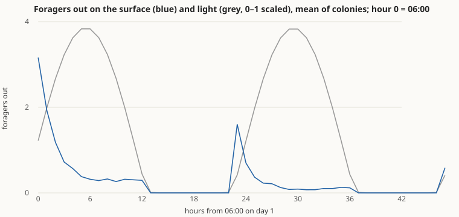
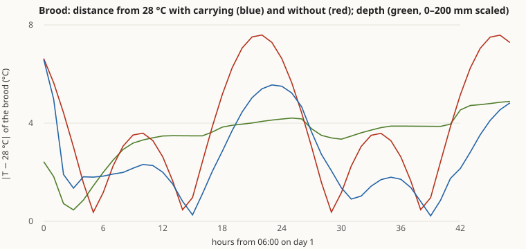
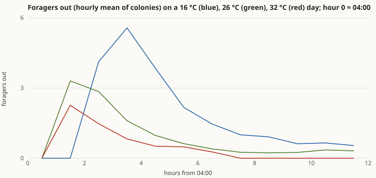
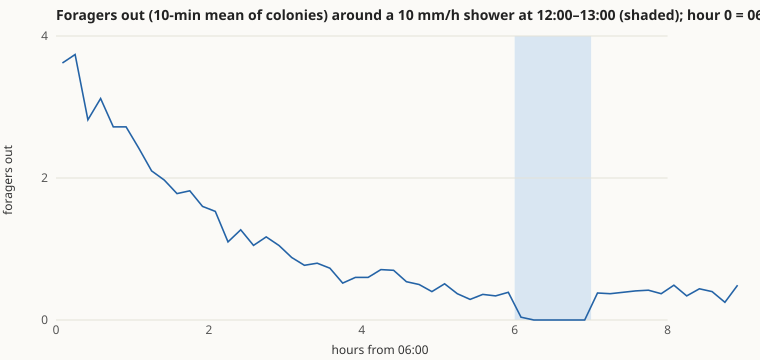
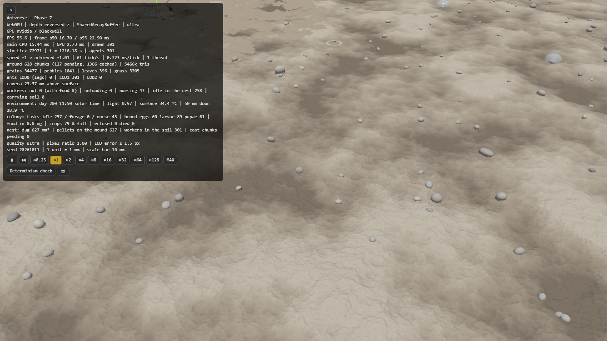
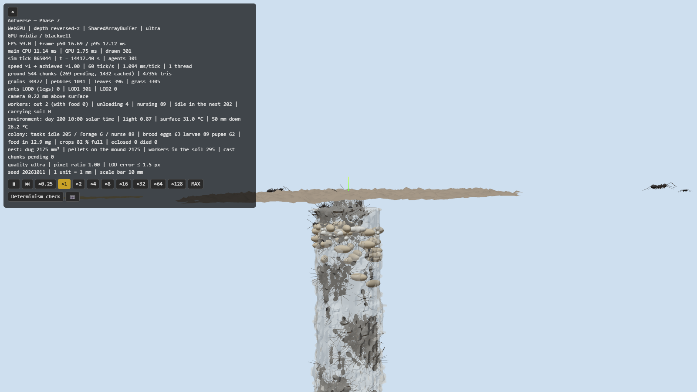
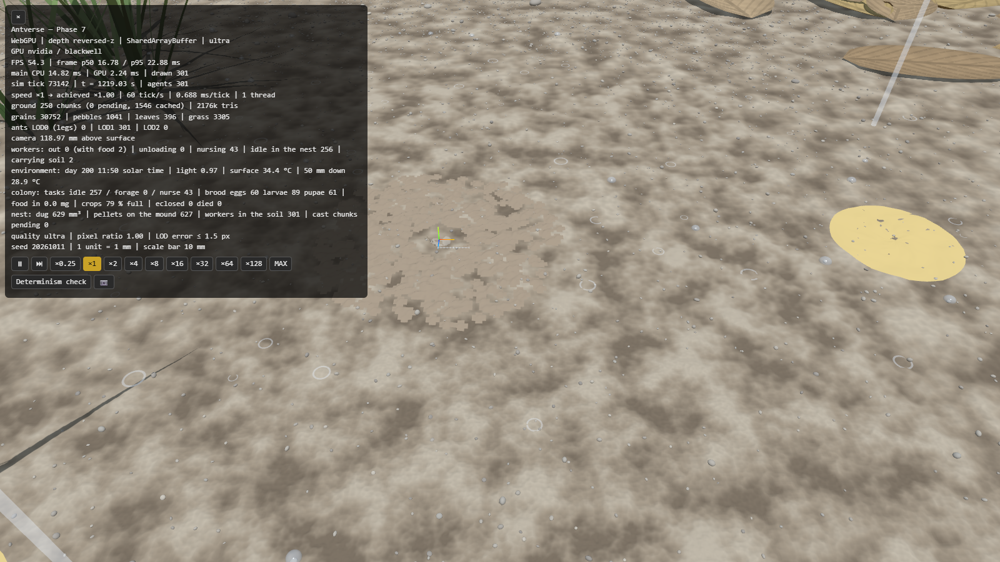
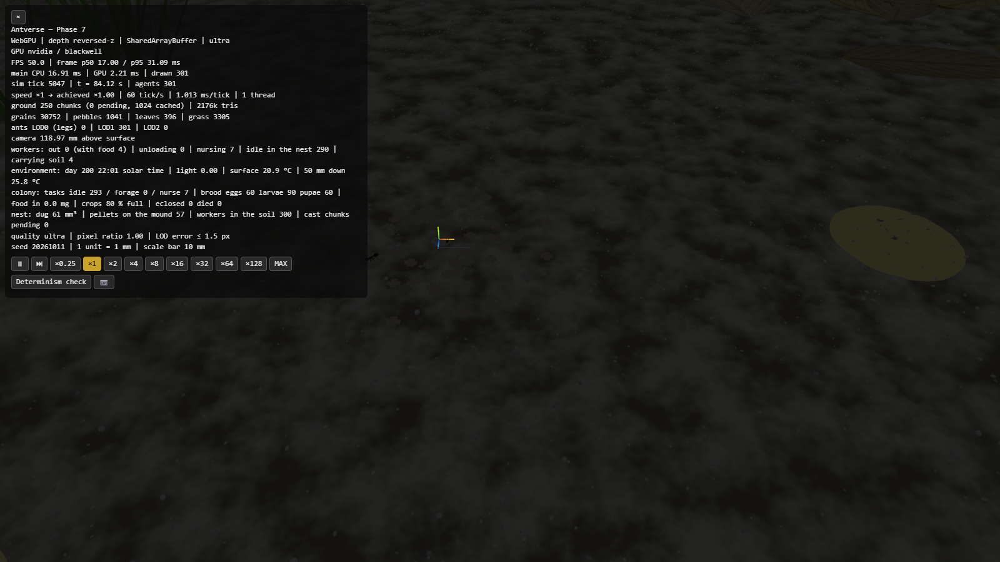

# Phase 7 報告 — 環境（昼夜・温度・雨・水滴）

- 日付: 2026-10-13
- 計測環境: NVIDIA GeForce RTX 5070 Ti / Chrome（WebGPU、ultra 画質）/ Node 24.19 / Intel Core Ultra 7 265K（20 論理コア）/ 1600×900
- 設計: [ARCHITECTURE.md §4.9](../ARCHITECTURE.md)、根拠: [BIOLOGY.md](../BIOLOGY.md)（PHY-ENV-001〜004、BIO-ENV-001〜004、ASM-ENV-001〜006、BIO-COL-005、ASM-COL-013、ASM-SOC-001）、[ENGINEERING.md](../ENGINEERING.md)（ENG-ENV-001/002、ENG-SIM-009、ENG-REN-018/019、ENG-EXP-005）
- 前提（推奨案で進めた）: Phase 6 の判断事項は推奨どおり（動員の基準を Phase 7 へ移す、除去は対照と比べる形で確定、地表の衝突を Phase 7 の最初に切り替え式で入れる、ASM-COL-012 を残す）。Phase 7 の基準は元の指示書「昼夜・雨・水滴がアリの行動に影響を与える」を、着手時に私が測れる形に定めた（下記、開発中の変更点は §5 で確認をお願いします）。

**結論: Phase 7 の基準（昼夜・育房の温度・温度・雨と水滴・性能）はすべて合格しました。Phase 6 から移した「道しるべによる動員」は、今回も効果が出ませんでした（× 0.99）。** この項目の扱いを §5 で決めていただきたいです。

## 1. 実装内容の要約

| 領域 | 実装 |
|---|---|
| 地表の衝突（Phase 6 から） | 地表の個体を 5 mm 区画に並べた索引を共有メモリに置き、前方の仲間から曲がって離れる。すぐ前（0.6 体長）にいればその場で向きを変える。シナリオごとの切り替え（Phase 2〜5 の判定に使ったシナリオではオフ） |
| 太陽と明るさ | 太陽の位置（北緯 35.7°、7 月中旬、地方太陽時）、明るさ（薄明で 0 へ）。新しい層 `src/env/` はシミュレーションと描画が同じものを使う |
| 温度 | 地表は日平均 26 °C ± 10 °C（14 時が最高）。土の中は深さ 10 cm で振幅が 1/e に減り、位相が遅れる（熱伝導の周期解） |
| 温度の影響 | 歩く速さ・代謝・育房の発育が Q10 = 2 で変わる（5 °C 以下と 45 °C 以上では動けない、35 °C より上で下がる）。採餌に出るのは明るく、地表が 12〜38 °C のときだけ。暗く・暑く・寒くなったら外の個体は帰る |
| 育房の温度調節 | 世話係は、好み（28 °C）から 2 °C より外れた所で、上か下により良い温度があれば育房を拾い、温度の良い方へ運んで置く（`Request.PICK/PUT`） |
| 雨 | 予定（開始・長さ・強さ）に従って降る。雨粒が当たったアリは数 mm 押され、2〜10 s 動けない。雨の間は採餌に出ず、外の個体は帰る。道しるべは洗い流される（寿命 1/10） |
| 水滴 | 落ち葉や小石の上（土の上は染み込む）に水滴ができ、触れ合うと合わさり、温度と湿度で蒸発する（d(r²)/dt 一定）。アリは水滴を障害物として避け、水滴ができた所にいたアリは 20〜120 s 抜け出せない |
| 表示 | 太陽の向きと強さ、昼夜の空の色、半透明の水滴、降る雨粒の筋と水しぶき、HUD の時刻・明るさ・温度。`?preset=field` または `#field` |
| 実験 | `scripts/experiment-environment.ts`（80 試行を 19 並列で 3.8 時間）、`scripts/plot-environment.ts`、`browser-run.ts weather` |
| テスト | 34 ファイル・805 件、すべて合格 |

## 2. 合格基準の達成状況

### 手順（ENG-EXP-005）

開発中に使っていないシード 7001〜7010 の 10 コロニー（`field`：300 匹、環境・衝突回避あり、06:00 開始）。

### 結果

| 基準 | 結果 | 判定 |
|---|---|---|
| 1. 昼は夜の 5 倍以上、採餌係が地表に出る | 10/10（昼 0.46〜0.54 匹、夜 0） | **合格** |
| 2. 育房を運ぶと、運ばない対照より好み（28 °C）からのずれが 30% 以上小さい（2 日目） | 10/10（2.38〜2.66 °C 対 3.78〜3.82 °C、30〜37% 小さい） | **合格** |
| 3a. 涼しい日（平均 16 °C）は採餌の始まりが 0.5 時間以上遅い | 10/10（6:27 対 5:14） | **合格** |
| 3b. 暑い日（平均 32 °C）は昼（12〜16 時）の採餌係が平年の日の 30% 以下 | 10/10（0 対 0.25〜0.34 匹）。取り込みも約 21 mg 対 約 37 mg に減る | **合格** |
| 4a. 雨（12〜13 時、10 mm/h）で採餌係が雨の前の 20% 以下、2 時間後までに 50% 以上に戻る | 10/10（雨の前 0.20〜0.68 → 雨の間 0 → 後 0.30〜0.57） | **合格** |
| 4b. 自由に歩く個体が水滴に踏み込まない | 0 回（雨粒に当たった個体 7〜24 匹/コロニー、雨の終わりの水滴 38〜314 個 → 2 時間後 6〜65 個） | **合格** |
| 5. 1 万匹で 60 fps・決定論・並列で同じ結果 | 下の「性能と決定論」 | **合格** |
| （Phase 6 から）新しい遠い餌場の、見つかってから 2 時間の利用が、道しるべありでなしの 1.5 倍以上 | 24.1 回 対 24.4 回（× 0.99、20/20 試行で発見） | **不合格** |

CSV: [昼夜と育房](phase-7/environment-day.csv)・[時系列](phase-7/environment-day-series.csv)、[温度](phase-7/environment-temp.csv)・[時系列](phase-7/environment-temp-series.csv)、[雨](phase-7/environment-rain.csv)・[時系列](phase-7/environment-rain-series.csv)、[新しい餌場](phase-7/environment-food.csv)

1 日目の朝、育房は深さ約 60 mm（最初の穴の底）から、暖まった浅い層（5〜20 mm）へ運ばれ、午後には暑くなった上層を避けて深く戻ります。2 日目には巣がその深さ（約 90〜100 mm）まで掘り進められていて、育房は日中も好みに近いそこに留まり、上下はあまり大きくありません（ずれの小ささは保たれています）。

**注意すべき点:**
- 昼夜の差は、主に「明るいときだけ採餌に出る」という規則（BIO-ENV-002）によるもので、昼夜のリズムが規則から自然に生まれたわけではありません。
- 雨の前後の数は、平衡状態の採餌係が少ない（Phase 6 の判断事項 3）ため、0.2〜0.7 匹の平均の比較です。
- 涼しい日は採餌係を増やして補うので、取り込み量自体はほとんど減りません（約 37 mg）。暑い日は昼に止まるぶん、約 4 割減ります。

### 動員がまた効かなかったこと

| | 道しるべあり | なし |
|---|---|---|
| 新しい餌場が見つかるまで（開始から） | 2.00〜2.30 時間 | 2.03〜2.32 時間 |
| 見つかってから 2 時間の利用（回） | 12〜36（平均 24.1） | 17〜40（平均 24.4） |
| 利用した個体の数 | 8〜25 | 10〜29 |

開発用シードでは、道しるべありの方が少ない（× 0.61）こともありました。既にある餌場への道に個体が引かれ、新しい餌場を使い始めるのが遅れる現象で、*Lasius niger* で「豊かな新しい餌に乗り換えられない」と報告されている現象（Beckers ら 1990）と同じ向きです。判定のシードでは差はほぼゼロでした。Phase 6 の分析（個体の記憶が強い、探索中にも道しるべを置く、往来が少ないと道しるべが弱い）と合わせ、このモデルでは道しるべは「集団で道を選ぶ」（Phase 3 の二重橋）には効くが、「新しい餌に仲間を呼ぶ」にはほとんど効かない、という結果です。

## 3. 性能と決定論

| 項目 | 結果 |
|---|---|
| 既定のシナリオ 1 万匹（地表） | 8 スレッド、13.1 ms/tick、59.9 fps（p95 18.7 ms） |
| `field` 1 万匹（衝突・環境あり、最初の穴 30 × 100 mm、10:00） | 8 スレッド、8.1 ms/tick、59.0 fps（p95 23.1 ms） |
| 同じく雨（30 mm/h）の中 | 8 スレッド、6.8 ms/tick、59.9 fps（p95 20.6 ms） |
| ブラウザ内のライブ実行（8 スレッド）とヘッドレス計算 | `field` 5,000 匹・雨の中で一致 |
| 補助スレッドとの等価性テスト | 衝突回避（地表の索引）を含めて一致 |
| 状態ハッシュの基準値 | 新しいフィールド（運搬中の育房・動けない時間）と餌場ごとの記録が加わったため更新。既定・二重橋・ホーミング・掘削・コロニーは、位置の比較で挙動が変わっていないことを確認 |

既定のシナリオの ms/tick が Phase 6（9.0）より増えて見えますが、どちらも 60 fps を保っています（計測時の違いか、新しい規則の分岐の分かは未調査です）。

### 他の Phase への影響（再判定）

| 項目 | 結果 |
|---|---|
| Phase 6 のコロニーの判定をやり直し（下の不具合の修正後、[CSV](phase-7/colony-recheck-removal.csv)） | 除去 8/10（対照比 0.53〜1.04、中央値 0.98。前回 10/10）→ 基準 80% ちょうどで合格。齢間分業 10/10、食料収支 10/10（餌あり 209〜233 mg・幼虫 +10.5〜11.6 mg、餌なし 135〜142 mg・+4.8〜5.1 mg）→ 合格のまま。動員 × 1.00 → 不合格のまま |
| Phase 5 の掘削の判定をやり直し（[CSV](phase-7/digging-recheck.csv)） | 飽和 20/20、V = 1906 + 52.4·N mm³、R² = 0.980、すべてつながり保存 → 合格のまま（Phase 6 の再判定と同じ値） |

## 4. スクリーンショット（[phase-7/](phase-7/)）

| | |
|---|---|
|  雨の 20 分後の地表（11:50、30 mm/h）。落ち葉や小石の上の水滴と、雨粒の水しぶき |  10:00 の巣（地上を外し、半透明の鋳型ごし）。暖まった上層に繭と幼虫が集まっている |
|  雨の中の採餌場（採餌係は巣にこもっている） |  22:00。夜は採餌に出ない |

## 5. 判断していただきたいこと

1. **動員（2 度目の不合格）。** 選択肢:
   - **A: 受け入れて先へ進む。** このモデルでは道しるべは集団の道選び（Phase 3）には効くが、新しい餌への動員にはほとんど効かない、を結果として記録する。*Formica* には道しるべで動員しない種もいます。
   - **B（推奨）: 動員の規則を足して、Phase 8 の最初に再判定する。** 元の指示書は「個体間相互作用：触角接触、栄養交換、動員」を再現すべき要素に挙げているので、動員の仕組みがないままにはしたくありません。候補は (1) 餌を持ち帰った個体が巣の中で触れた仲間の採餌への刺激を上げる（接触による動員、*Formica* の一部で報告がある）、(2) コロニーでは探索中は道しるべを置かず、餌を持ち帰る時だけ置く。どちらも、まず原典（クロヤマアリの「餌の種類による情報伝達様式の相違」、島根大学の紀要）を確かめてから入れます。
   - C: 基準そのものを外す。
2. **Phase 7 の基準の決め方（確認）。** 着手時の私の案から、開発用シードで試して次の 3 点を変えました。
   - 温度は「取り込み量」ではなく「採餌の時間帯」（涼しい日の開始の遅れ、暑い日の昼休み）で測る。取り込み量は需要で決まり、涼しい日は採餌係を増やして補うため変わらなかった。
   - 育房は「好みの温度からのずれ」だけで判定し、深さの日周期は記録にとどめる。2 日目には巣が深くなり、上下が小さくなったため。
   - 水滴への踏み込みは「自分で歩いて乾いた所から入った場合」だけ数える（雨粒で押された、水滴が広がって覆った場合は捕まったものとして別に扱う）。
3. **Phase 6 の結果に影響した不具合を直しました（§6）。** やり直すと、除去の基準は 10/10 から 8/10 に下がりました（基準 80% ちょうど）。採餌係が 3〜4 匹と少なく、1〜2 匹の除去で比がばらつくためで、余裕のない合格です。Phase 6 の判断事項 3（採餌係が少ない）と合わせ、餌の分布を自然に近づける時に見直したいです。
4. **見送ったもの（Phase 8 以降の候補）。**
   - 景色（スカイライン）の記憶による帰巣（Phase 4 から Phase 7 へ送っていた項目）。推奨: Phase 8 の後、必要なら別の Phase で。
   - 土の水分（雨が染み込んだ土で掘りやすくなる等）、朝露、巣の形（縦穴＋部屋）の再評価。育房の温度調節で巣が育房のいる深さへ掘り進む様子は見えましたが、部屋に分かれるまでには至っていません。
5. **持ち越し**（まだ返答をいただいていないもの）: Git 履歴から 28 MB を消すか（強制プッシュが必要）、Phase 1 の地形の端の扱い、文献の原典確認。

## 6. 「仮定」として置いたパラメータと、開発中の変更

### 根拠と仮定（BIOLOGY.md / ENGINEERING.md に登録済み）

| ID | 内容 | 値 | 確度 |
|---|---|---|---|
| PHY-ENV-001 | 太陽の位置と明るさ | Cooper の赤緯式、薄明 −6° | 一般式 |
| PHY-ENV-002 | 土の中の温度 | 減衰深さ 10 cm | 一般値 |
| PHY-ENV-003 | 雨粒 | 直径 2 mm | 一般値 |
| PHY-ENV-004 | 水滴の蒸発 | d(r²)/dt 一定、半径 1 mm で 30 分（25 °C・湿度 60%）、11 °C で 2 倍 | 一般式・寿命は桁合わせ |
| BIO-ENV-001 | 温度が上がると速く歩く | Q10 = 2 | 他種を含むまとめ（要旨）・値は仮定 |
| BIO-ENV-002 | 昼に、適温で採餌 | 明るさ 0.05 以上、12〜38 °C | 二次資料・値は仮定 |
| BIO-ENV-003 | 小さな昆虫は雨粒で死なない | — | 他の昆虫（蚊） |
| BIO-ENV-004 | 雨の間は採餌しない | — | 二次資料 |
| BIO-COL-005 | 育房を好みの温度へ運ぶ | 28 °C | 他属・二次資料 |
| ASM-ENV-001 | 地表の温度 | 26 ± 10 °C、14 時最高 | 仮定 |
| ASM-ENV-002 | 温度への反応の限界 | 5 / 35 / 45 °C | 仮定 |
| ASM-ENV-003 | 雨粒に当たったアリ | 最大 3 mm 押され、2〜10 s | 仮定 |
| ASM-ENV-004 | 水滴ができる所と捕まること | 葉や小石の上、0.002 個/mm²/mm、半径 0.5〜2 mm、20〜120 s | 仮定 |
| ASM-ENV-005 | 湿度 | 60%、雨で 100%、2 時間で戻る | 仮定 |
| ASM-ENV-006 | 雨が道しるべを流す | 寿命 1/10 | 仮定 |
| ASM-COL-013 | 育房を運ぶ規則 | ±2 °C、5 mm の上下、0.05/s、最長 300 s | 仮定 |
| ASM-SOC-001 | 地表で仲間とぶつからない | 0.9 体長、最大 6 rad/s、0.6 体長で止まる | 仮定（Couzin & Franks 2003） |

### 開発中に見つけて直したこと

| 現象 | 原因 | 対処 |
|---|---|---|
| 土を捨てた後、巣口に戻れず 200 mm 先まで迷う個体が多い（Phase 6 のコロニーでも起きていた） | 荷下ろしのタイマーに「探索時間」の欄を流用し、消していなかった。後で土を運んだとき「巣口が見つからず探索中」と誤解し、広い探索の輪に出た | 地上に出たときと荷下ろし・運搬の終わりに消す。再現テストを追加。Phase 6・5 の判定をやり直した |
| 暑い時間に水滴に踏み込む | 水滴の判定に、温度で速くなる前の一歩の長さを使っていた | 温度で補正した一歩で判定 |
| 密集すると仲間と重なる（曲がるだけでは 14% しか減らない） | 曲がるだけでは避けきれない | すぐ前に仲間がいたら、その場で向きを変える |
| 雨の表示で水しぶきが残り続ける | 早送り中に作ったしぶきを実時間で消していた | シミュレーション時間で消す |
| 撮影中にページが再読み込みされる | 撮影中に設定ファイルを編集し、開発サーバーが再読み込みした | 撮影中は編集しない |

開発中の確認には既定のシード（20261011）とシード 1〜13 を使い、判定のシード（7001〜7010）は使っていません。

## 既知の制約

- 動員が新しい餌の利用を増やさない（§5-1）。
- 昼夜のリズムは光の規則によるもので、体内時計（概日リズム）は持たない。
- 地表は一様な温度（日なたと日陰、落ち葉の下の違いはない）。土の湿り気は持たない。
- 雨粒は当たるかどうかだけを計算し、空中の粒は追わない（表示は同じ割合で描くだけ）。水たまり・流水・巣の浸水はない。
- 夜の表示は見やすさのため周りの光を残している（シミュレーションの明るさは 0）。
- 文献値の確認、ブラウザ間の決定論、実機のスマートフォン、WebGL2 での性能は、引き続き未確認。
