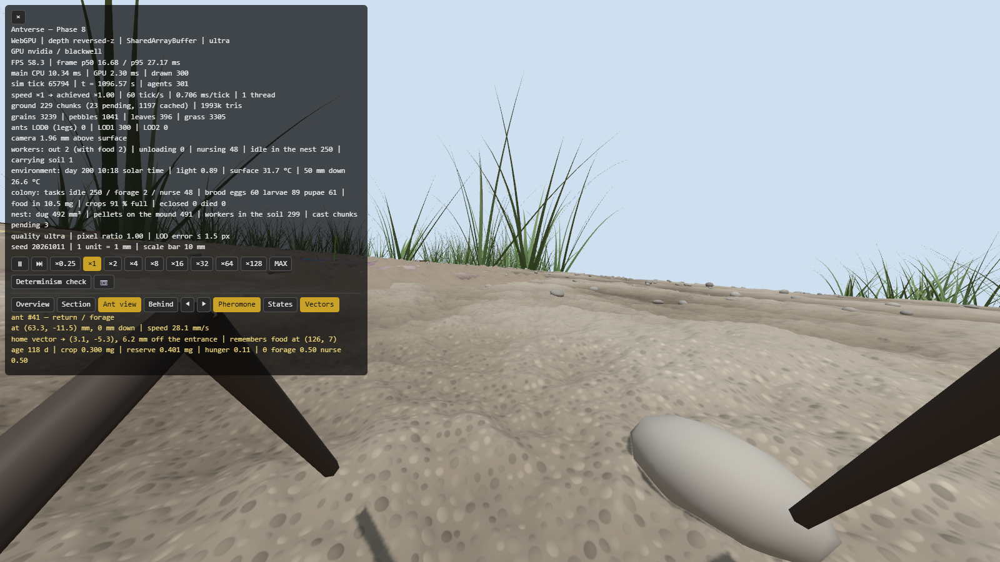
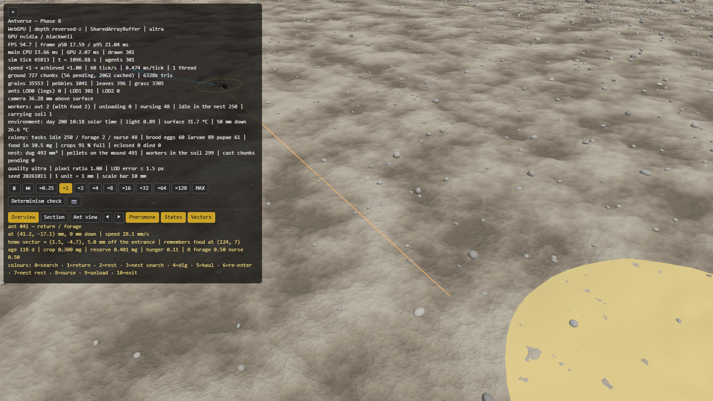
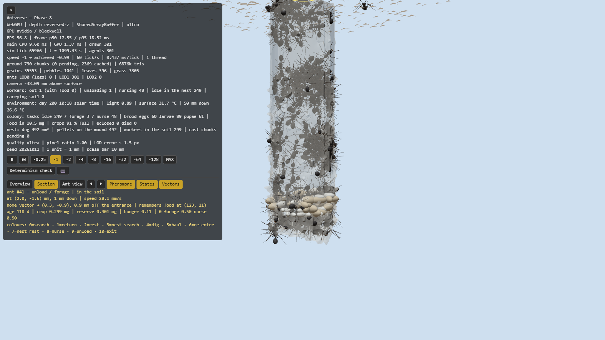
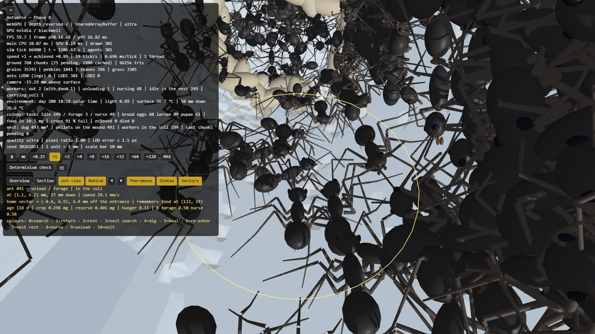
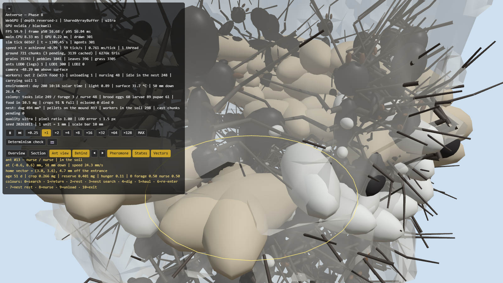
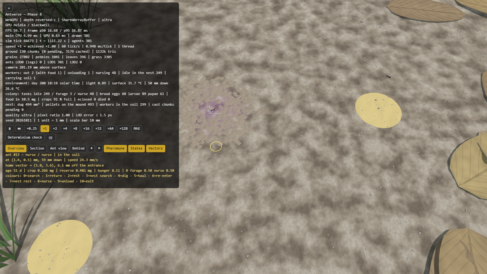
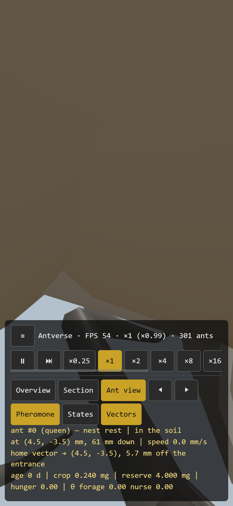
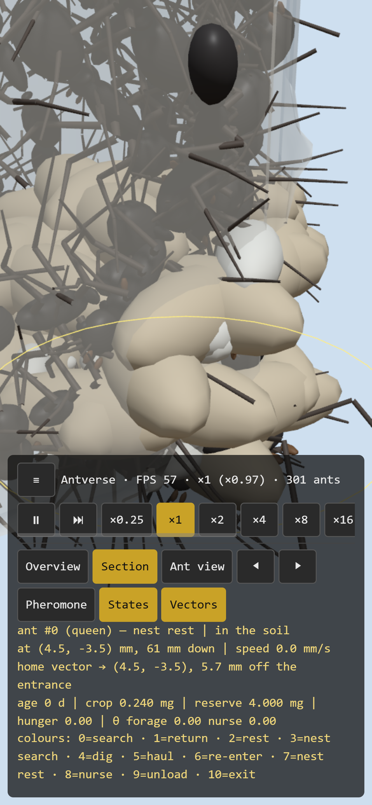
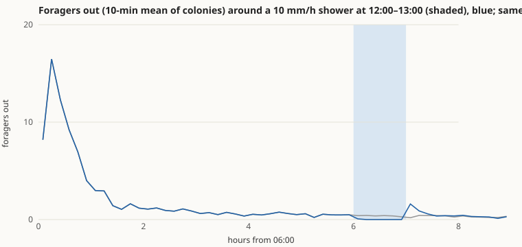

# Phase 8 報告 — 観察 UI（と、持ち越していた動員）

- 日付: 2026-10-14
- 計測環境: NVIDIA GeForce RTX 5070 Ti / Chrome（WebGPU、ultra 画質）/ Node 24.19 / Intel Core Ultra 7 265K（20 論理コア）/ 1600×900、スマホは Chrome の端末エミュレーション（390×844、DPR 3、タッチ）
- 設計: [ARCHITECTURE.md](../ARCHITECTURE.md)、根拠: [BIOLOGY.md](../BIOLOGY.md)（BIO-COL-006、ASM-COL-014）、[ENGINEERING.md](../ENGINEERING.md)（ENG-UI-002、ENG-EXP-005）
- 前提（推奨案で進めた）: Phase 7 の判断事項は推奨どおり（動員は文献を確かめてから Phase 8 の最初に「巣の中での呼び起こし」を加えて測り直す、Phase 7 の基準の変更を確定、スカイラインの記憶・土の湿り気・巣の形は先送り）。Phase 8 の基準は元の指示書「観察モード（俯瞰カメラ、地上／地下断面の切り替え）、アリ視点モード（1 匹を追跡し、その視界で見る）、デバッグ表示（フェロモン濃度のヒートマップ、個体の状態、帰巣ベクトル）を切り替えられる」を、着手時に私が測れる形に定めた（下記）。

**結論: Phase 8 の基準（視点・選択・デバッグ表示・スマホ・性能）はすべて合格しました。持ち越していた動員も、開発に使っていないシードで × 1.70 になり合格です。** 動員を入れてコロニーの動きが変わったので Phase 6・7 を測り直したところ、Phase 7 の雨の基準だけが 10/10 から 7/10 に下がりました。原因は計り方（下記 §2.3）にあると考え、雨を降らせない対照と比べる形に変えると 10/10 です。この基準の変更は §5 で決めていただきたいです。

## 1. 実装内容の要約

| 領域 | 実装 |
|---|---|
| 動員（Phase 6 から持ち越し） | 餌を持ち帰った個体（「成功」の印）が、巣の中で待機中の仲間に口移しをしている間、1/60 s ごとに 2% の確率でその仲間を「動員」する（採餌係になり、巣の外へ向かう）。コロニーでは、道しるべは餌を持って帰る個体だけが引き、それをたどるのは動員された個体だけ（*F. fusca* の、道しるべ自体には呼ぶ働きがなく誇示で呼び起こされた個体だけがたどる、という観察。BIO-COL-006） |
| 視点 | 1 俯瞰（従来のオービット）、2 断面（地上を外し、カメラを地下にも入れる）、3 アリ視点（観察中の個体の頭に乗り、その体の向きで見る。視野 100°。その個体自身は描かず、地下ではその個体の周りの地面を外す） |
| 個体の選択 | 画面のアリをクリック／タップ（24 px 以内で最も近い個体）、◀ ▶（N / P）で次の個体、Esc で解除 |
| デバッグ表示 | フェロモンのヒートマップ（H）、状態ごとの色（C、11 状態）、観察中の個体の帰巣ベクトル・本当の巣口・覚えている餌場の線（V）、個体の詳細パネル（状態・役割・位置・深さ・速さ・帰巣ベクトルとその誤差・覚えている餌場・齢・素嚢と貯え・空腹・反応閾値。女王は素嚢と貯えだけ） |
| 作業スレッドとの連絡 | `inspect`（1 匹の詳細）と `states`（全個体の状態と役割）を 250 ms ごとに問い合わせる。写しを受け取るだけで、シミュレーションの結果は変えない |
| スマホ | 観察のボタンは折り返して全部が画面に収まる（速さのボタンは従来どおり横にスクロール） |
| 雨の実験 | 同じシードで雨を降らせない対照を加えた（§2.3） |
| 検証 | `browser-run.ts observe`（すべての視点と切り替えを操作し、数値と画像を残す）、`browser-run.ts mobile`（タッチでボタンを押す） |
| テスト | 34 ファイル・826 件、すべて合格（動員の 3 件、状態名の表と本体の対応を含む） |

## 2. 合格基準の達成状況

### 2.1 観察 UI

`node scripts/browser-run.ts observe`（`field`、10:00 開始、15 分進めてから操作）と `node scripts/browser-run.ts mobile - "<url>?preset=field&set=env.startHour=10"` で確かめました。数値は [views.json](phase-8/views.json)。

| 基準 | 結果 | 判定 |
|---|---|---|
| 1. 俯瞰・断面・アリ視点を切り替えられる。断面ではカメラが地面の下に入れる | 3 つとも切り替わる。断面でカメラが地表より下にある（`sectionCameraBelowGround: true`） | **合格** |
| 2. アリ視点はその個体に乗って追跡する | 地表の採餌係（#41）と巣の中の世話係（#13）で確認。3 秒間、カメラと個体の距離が 2.423 mm で一定（頭の位置）。その個体自身は描かない | **合格** |
| 3. 個体を選べる | クリック（24 px 以内）、◀ ▶、スマホのタップで選べる | **合格** |
| 4. デバッグ表示を切り替えられる | ヒートマップのオン／オフ、状態の色（301 匹すべてに色がつく）、帰巣ベクトル・本当の巣口・餌場の線、詳細パネル | **合格** |
| 5. スマホで使える | 観察のボタン 8 個がすべて画面内（右端 372 px／幅 390 px）、横スクロールなし、高さ 36 px。タップで視点・状態の色・ヒートマップが切り替わる | **合格** |
| 6. デバッグ表示をすべてオンにしても 1 万匹で 60 fps を保つ | 下の §3。今日のこの PC ではアリ 10 匹でも 56.3 fps が上限で、1 万匹・全部オンで 56.3〜56.5 fps（上限に張り付いている） | **合格**（上限で判定） |

| | |
|---|---|
|  採餌係（#41）の視点。地表 1 mm の高さから、前方の草と小石。手前の黒い棒は近くの仲間の脚 |  俯瞰で #41 を選んだところ。黄色の輪、帰巣ベクトル（矢印）、本当の巣口への線、覚えている餌場への線（橙）、状態の色の凡例 |
|  断面。地上を外して地下から巣を見る |  同じ #41 を数秒追ったところ。巣に戻って荷を下ろしている（巣の中の仲間がすぐ前にいる） |
|  世話係（#13）の視点。すぐ前に蛹がある |  フェロモンのヒートマップ |

スマホ（390×844）:  

**注意すべき点:**
- **巣の中のアリ視点は、目の前の仲間や育房で画面がほぼ埋まります**（04、スマホの 1 枚目）。混み合った部屋での本当の位置関係ですが、観察には向きません。§5 で扱いを伺います。
- アリ視点は「頭の位置にカメラを置いた」もので、アリの複眼の見え方（視野の広さ、低い解像度、偏光や紫外線）を再現したものではありません。

### 2.2 動員（Phase 6 から持ち越した基準）

手順（ENG-EXP-005）: 開発中に使っていないシード 8001〜8010 の 10 コロニー（`field`）。開始 2 時間後に (−170, −90) mm に新しい餌場が現れ、ほかに餌はない。最初に見つかってから 2 時間に、そこでそ嚢を満たした回数を、動員あり（帰り道の道しるべ＋巣の中の呼び起こし）となし（どちらもなし）で比べる。

| 基準 | 結果 | 判定 |
|---|---|---|
| 新しい餌場の利用が、動員ありでなしの 1.5 倍以上（平均） | 252.1 回 対 147.9 回（**× 1.70**）。全 10 シードで「あり」の方が多い（195〜290 回 対 122〜176 回）。使った個体の数も 127〜170 匹 対 73〜100 匹。20/20 試行で発見 | **合格** |

Phase 7 のシード（7001〜7010）でも × 1.64（238.3 回 対 145.7 回）で、Phase 7 の時点（× 0.99）から変わりました。CSV: [8001〜](phase-8/recruit8-food.csv)、[7001〜](phase-7/environment-recheck-food.csv)

**ほかに餌場がある場合（参考、基準ではない）:** 同じ手順で、最初からある 2 か所の餌場を残したままにすると、**動員ありの方が新しい餌場の利用が少なくなります**（16.1 回 対 23.2 回、× 0.69、見つかるのも 2.01〜2.29 時間 対 2.00〜2.11 時間と遅い）。開発中の試行（× 0.71）と同じ傾向です。動員された個体が既にある餌場の道しるべに乗るので、新しい場所を探しに出る個体が減るためです。道しるべを使う *Lasius niger* では、後から現れたより良い餌場に切り替えられない現象として知られています（Beckers et al. 1990）。CSV: [ほかに餌場あり](phase-8/recruit8-existing-food.csv)

### 2.3 Phase 6・7 の測り直し（動員でコロニーの動きが変わったため）

同じシード（Phase 6: 6001〜、Phase 7: 7001〜）で全項目をやり直しました。

| 基準 | Phase 6／7 の報告時 | 今回 | 判定 |
|---|---|---|---|
| P6 除去からの回復（対照の 80% 以上） | 8/10（Phase 7 の修正後） | **10/10**（対照比 0.85〜1.26） | 合格 |
| P6 齢による分業 | 10/10 | 10/10 | 合格 |
| P6 餌の収支（48 時間） | 10/10 | 10/10 | 合格 |
| P7 昼夜 | 10/10 | 10/10（昼 0.64〜0.78 匹、夜 0） | 合格 |
| P7 育房の温度 | 10/10 | 10/10（2.32〜2.63 °C 対 3.78〜3.82 °C） | 合格 |
| P7 涼しい日の始まり | 10/10 | 10/10（6:27 対 5:14） | 合格 |
| P7 暑い日の昼 | 10/10 | 10/10（0 匹 対 0.25〜0.40 匹） | 合格 |
| P7 雨（雨の前の 1 時間と比べる、Phase 7 の形） | 10/10 | **7/10** | **不合格** |
| P7 雨（雨のない対照と比べる、今回の提案） | — | **10/10** | 合格 |
| P7 水滴に踏み込まない | 0 回 | 0 回 | 合格 |

CSV: [Phase 6](phase-6/colony-recheck2-removal.csv)・[収支](phase-6/colony-recheck2-economy.csv)、[昼夜](phase-7/environment-recheck-day.csv)、[温度](phase-7/environment-recheck-temp.csv)、[雨](phase-7/environment-recheck-rain.csv)

**雨で何が起きたか:** 雨の間はどのコロニーも採餌係が 0 匹になり、雨のあとは戻ります（下の図）。下がったのは「戻り」の判定で、原因は計り方にあります。

1. 採餌係は 1 日の中で減っていきます（朝に多く出て、満腹になるにつれて平衡の 0.3 匹ほどに落ちる）。動員が入って朝の山が大きくなり（開始 30 分で平均 12 匹、以前は 3 匹）、「雨の前の 1 時間」（11〜12 時）はまだその下り坂の途中です。
2. 雨のない対照でも、10 コロニー中 8 つで 14〜15 時の採餌係は 11〜12 時より少なく、7006 では 0.55 → 0.13 匹です。比べているのは 0.2〜0.6 匹という平均なので、1 匹の出入りで比が大きく揺れます。
3. 同じシードで雨を降らせない対照を同じ時間帯で比べると、雨の間は 0 匹（対照 0.16〜0.70 匹）、雨の 1〜2 時間後は対照の 65〜200% で、10/10 が基準を満たします。雨の後に一度に出ていく山（13 時台の平均 1.0 匹）も見えます。

Phase 6 の除去実験で、同じ理由（自然な変化と区別できない）から対照と比べる形に変えたのと同じ考え方です。ただし、結果を見てから基準を変えることになるので、§5 で決めていただきたいです。

## 3. 性能と決定論

| 項目 | 結果 |
|---|---|
| ブラウザの描画の上限（今日のこの PC、アリ 10 匹、requestAnimationFrame を 600 回） | **56.3 fps**（画面は 59 Hz。Phase 7 の計測時は 59.9 fps 出ていたので、今日の PC かブラウザの状態による） |
| `field` 1 万匹（最初の穴 30 × 100 mm、10:00）、デバッグ表示すべてオフ | 8 スレッド、8.1 ms/tick、56.6 fps（p50 17.62 / p95 19.81 ms） |
| 同じく、ヒートマップ・状態の色・個体の選択と帰巣ベクトルすべてオン | 8 スレッド、9.1 ms/tick、56.3 fps（p50 17.63 / p95 21.41 ms） |
| 300 匹（観察の撮影時） | 54.7〜56.8 fps |
| 決定論 | 雨の実験をやり直した 10 コロニーは、前回の実行と全数値が一致（同じシードで同じ結果） |
| 観察の問い合わせ | 写しを読むだけで状態は書き換えない（`inspect`／`states`）。状態ハッシュの基準値は変わらない |

どの条件でも描画は上限に張り付いていて、デバッグ表示によるフレームの遅れは見られません。ms/tick は 1 ms ほど増えますが、1 ティックの予算（16.7 ms）の半分ほどです。60 fps そのものは今日のこの PC では出ないので、上限との比較で判定しました。

## 4. 仮定の一覧（今回加えたもの・変えたもの）

| ID | 内容 | 確度 |
|---|---|---|
| BIO-COL-006 | 動員は「巣の中の誇示と口移しで呼び起こし、呼び起こされた個体だけが帰り道の道しるべをたどる」（*F. fusca*。クロヤマアリは要旨のみで確認） | 近縁種・要旨のみ |
| ASM-COL-014 | 口移しの間、1/60 s ごとに 2% の確率で動員（1 s 続けば約 7 割）。巣が満腹で口移しが起きないときは動員も起きない | 仮定（値） |
| （`colony.trailForRecruits`） | コロニーでは、道しるべを引くのは餌を持つ帰り道だけ、たどるのは動員された個体だけ。Phase 3〜4 の二重橋・ホーミングのシナリオは従来どおり | BIO-COL-006 による |
| ENG-UI-002 | アリ視点のカメラは体長の 0.45 前・0.18 上、4 体長先を見る、視野 100°。状態の色の選び方。問い合わせは 250 ms ごと | 表示のための選択 |
| ENG-EXP-005（変更の提案） | 雨の基準を、雨のない対照の同じ時間帯と比べる形にする | §5 で決めていただく |

## 5. 判断していただきたいこと

1. **雨の基準を「雨のない対照と比べる」形に変えてよいか。**
   - 推奨: **変える**。理由は §2.3 のとおりで、Phase 6 の除去実験と同じ扱いです。Phase 7 の形（7/10）も報告に残します。
   - 変えない場合は、雨の前の比較が安定するように、採餌係が平衡に達した後（たとえば 2 日目）に雨を降らせる手順に変えて測り直します（約 1 時間）。
2. **ほかに餌場があると、新しい餌場の利用が動員ありの方が少なくなること（× 0.69）をどう扱うか。**
   - 推奨: **そのまま残し、性質として記録する**。仮定した規則から自然に出てきた結果で、*L. niger* でも観察されています。クロヤマアリは個体の道の記憶が強いので、実際はもっと切り替えが速いかもしれません。文献で確かめられたら、動員された個体がしばらくして探索に戻る規則を足すかを検討します。
3. **巣の中のアリ視点が見づらいこと。**
   - 推奨: アリ視点に「後ろから」の切り替えを足す（体長 3 つ後ろ・2 つ上から追う）。地表では一人称、巣の中では後ろからを既定にします。小さな UI の変更です。
4. **次に何をするか。** 元の指示書のフェーズは Phase 8 で終わりです。
   - 推奨の順:
     1. スマホ用の公開ページ（artifact）を Phase 8 の版に更新する。
     2. 先送りしている巣の形（*Formica* の縦坑と部屋）に取りかかる。断面で一番目につく部分です。
     3. 地表の記憶（スカイライン）、土の湿り気を足す。
5. **前から未回答のもの:**
   - git 履歴の 28 MB の削除（force push が必要）
   - Phase 1 の地形の端の扱い
   - BIO-PHE-001/002 などの原典の確認

## 6. 決定（2026-10-14、「進めて」で推奨案を採用）

1. 雨の基準は「雨のない対照と比べる」形に変更（ENG-EXP-005）。Phase 7 の雨の基準はこれで合格（10/10）。
2. ほかに餌場があるときの × 0.69 は、規則から出てきた性質として記録する（BIO-COL-006 の注記）。
3. 巣の中のアリ視点は、後ろ上から追う形を既定にした（3 体長後ろ・2 体長上、選択の輪を重ねる。B または「Behind」で切り替え）。04 の画像はこの形で撮り直した。
4. 性能の測り直し（2026-10-14、PC の描画が 60 fps に戻った後）: `field` 1 万匹、デバッグ表示すべてオフで 59.5 fps（p50 16.67 ms、6.5 ms/tick）、すべてオンで 59.5 fps（p50 16.67 ms、8.9 ms/tick）。§3 の 56 fps は当日の PC 側の上限でした。
5. 次は、公開ページの更新 → 巣の形（*Formica* の縦坑と部屋）→ スカイラインの記憶・土の湿り気。
